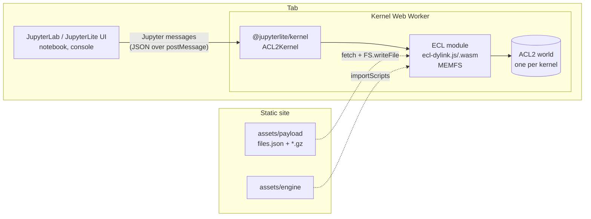

# ACL2 on JupyterLite — kernel design

Status: draft, 2026-11-09.  Written against `acl2-ecl` commit
(`ecl` branch) and the published site <https://jimwhite.github.io/acl2/>.
Everything quoted as a measurement below was measured in this repository; see
`WASM-PORT-NOTES.md` for the run-by-run detail.

This document is meant to move to the new kernel repository as `DESIGN.md`.
It assumes the ACL2 WebAssembly work in `acl2-ecl` as a **fixed dependency**:
the kernel does not build ECL, does not certify books, and does not know how
Lisp is compiled.  It consumes two artifacts (see §3).

---

## 1. Goal

Run real ACL2 inside a browser tab, as a JupyterLite kernel, so that a
notebook such as
[`acl2-jupyter/examples/notebooks/quine.ipynb`](https://github.com/jimwhite/acl2-jupyter/blob/main/examples/notebooks/quine.ipynb)
can be opened on a static web site and executed cell by cell, with no server
and no installation.

Concretely, the kernel must:

1. Execute ACL2 forms from code cells, one cell at a time, in one growing ACL2
   world, and print everything ACL2 prints (including proof output) as it
   appears, not at the end.
2. Support `include-book` for the books shipped in the payload, with
   `:dir :system` resolving to the payload's `books/` tree.
3. Report errors the way the Jupyter protocol expects — an ACL2 error in a
   cell must not kill the notebook.
4. Survive what the browser throws at it: a reload, a second tab, a user who
   runs a form that needs more stack than the tab has.
5. Not weaken ACL2.  Soundness is the whole point: no `skip-proofs` injected
   by the kernel, no rewriting of forms, `certify-book` available and working,
   and ACL2's own initialization checks must pass before the first prompt (they
   already do — `world-replay.lsp` runs `check-acl2-initialization`).
6. Match the existing notebook metadata, so existing `.ipynb` files work
   unchanged:

   ```json
   "kernelspec": {"display_name": "ACL2", "language": "acl2", "name": "acl2"},
   "language_info": {"codemirror_mode": "text/x-common-lisp",
                     "file_extension": ".lisp", "mimetype": "text/x-common-lisp",
                     "name": "acl2", "pygments_lexer": "common-lisp"}
   ```

### Non-goals

- Building ECL or ACL2 (that is `acl2-ecl`; the kernel pins its output).
- The full community `books/` tree.  The payload is a curated set — the page
  preloads it into an in-memory filesystem (§4.2).  Book selection is a
  `books.txt` change in `acl2-ecl`, not a kernel change.
- Running on a Jupyter server.  `acl2-jupyter` already covers the
  local-server case; the value here is the no-install case.
- Multi-user, multi-kernel-per-tab scheduling.  One tab, one ACL2 world.

---

## 2. What already exists, and what it proves

The ACL2 WebAssembly port reached "the page takes form after form" in
2026-11-08.  These are the pieces the kernel builds on, all in `acl2-ecl`:

| Piece | Where | What it gives the kernel |
| --- | --- | --- |
| ECL 26.5.5 + wasm patches | `jimwhite/ecl` branch `acl2-wasm` (on top of the "widen bytecode operands" commit `cb1e2e84`), mirrored as `wasm/ecl-patches/*.patch` | An interpreter that does not grow the VM stack per Lisp call, and three C entry points a host can call |
| Embedding entry points | `src/c/main.d`, `#ifdef __EMSCRIPTEN__` | `ecl_page_start()`, `ecl_page_load(path)`, `ecl_page_eval(text)` — the module can be entered once per cell and never reaches `SI:TOP-LEVEL` (which exits at end of input) |
| Browser module | `/opt/eclwasm/dist/web-dylink/{ecl.js,ecl.wasm}`, copied to `wasm/web/lib/ecl-dylink.*` | `-sMAIN_MODULE=1` so compiled Lisp modules (`.fasc`, wasm side modules) can be `dlopen`ed at run time |
| World-image replay | `wasm/world-replay.lsp` (Node), `wasm/web/replay-web.lsp` (page) | Boots ACL2 from a serialized post-boot-strap world instead of re-running the boot strap: 8.4 s to a prompt in the page |
| AOT compiled sources | `wasm/aot-book.sh`, `wasm/aot-acl2.lsp` | ACL2's own files and books as wasm side modules, loaded by `si::load-binary` |
| Certification pipeline | `wasm/certify-books.sh` | `certify-book` with `ACL2_SAVE_EXPANSION=1`, one book per session; the `.acl2` portcullis is applied first |
| Payload builder | `wasm/web/books.txt`, `wasm/web/make-manifest.sh`, `wasm/web/publish-gh-pages.sh` | `files.json` (170 files, 84.2 MB raw, ~9 MB gzipped) + gzipped copies, published to GitHub Pages |
| Reference host | `wasm/web/acl2-main.html`, `/tmp/webrun-page.js` | The exact call sequence the kernel must reproduce; the Node harness is a headless stand-in for it |

What is **not** proven, and is the kernel's problem: running any of this
inside a Web Worker (JupyterLite kernels are workers), and the stack budget
that goes with it (§4).

---

## 3. Artifacts the kernel depends on

Two immutable, versioned artifacts, both currently produced by `acl2-ecl`:

1. **The engine**: `ecl-dylink.js` + `ecl-dylink.wasm` (Emscripten, browser
   build, `-sMAIN_MODULE=1`, exported `_main,_ecl_page_start,_ecl_page_load,
   _ecl_page_eval`, runtime methods `FS,callMain,ccall`).
2. **The payload**: `files.json` plus one `.gz` per entry (ACL2 sources,
   `.fasc` modules, the world image chunks, certified books, and the replay
   driver), all addressed by absolute path inside the module's MEMFS.

Both are content-addressed by the ACL2/ECL commits that produced them.  The
kernel repository should treat them as **release assets** of `acl2-ecl`,
fetched by tag, with the producing commit recorded in the site build:

```
assets/
  engine/manifest.json      # {ecl_commit, acl2_commit, emscripten, flags, sha256s}
  engine/ecl-dylink.js
  engine/ecl-dylink.wasm
  payload/files.json
  payload/*.gz
```

Do not vendor them into git.  A kernel clone must be buildable and testable
with `make fetch-assets VERSION=<acl2-ecl tag>`.

---

## 4. Constraints this design is shaped by

### 4.1 The stack budget (the hard one)

V8's JS/wasm call stack is fixed per isolate and cannot be raised from a page.
Measured in Chromium 150 on a Linux arm64 container
(`wasm/web/_stackprobe.html`, re-measured 2026-11-09):

| Context | Max JS frames | ≈ bytes at V8's default 984 kB |
| --- | --- | --- |
| page (main thread) | 10,339 | ~984 kB |
| Web Worker | 5,301 | ~500 kB |

And ACL2's own requirements, measured by binary-searching
`node --stack-size=N` over the browser module driven exactly as the page
drives it:

| Operation | Needs | Fits page | Fits Chrome worker |
| --- | --- | --- | --- |
| boot to a prompt (world replay) | ~918 kB (floor) | yes, with 66 kB to spare | **no** |
| boot + `(include-book "textbook/chap11/qsort" :dir :system)` | 918 kB–1,000 kB; the book's own cost is smaller than the boot's and was not separated from it | yes | **no** |
| boot + `(include-book "projects/apply/top" :dir :system)` | ~1,090 kB | **no** | no |

The tutorial-book row is bounded below by the boot, so "does book X fit a
worker?" cannot be answered until the boot floor drops (§9, lever 1): at 480
kB *every* include failed, because the boot itself fails first.

Consequences, stated plainly:

- A Chrome worker **cannot boot ACL2 today**.  That is the first thing to fix
  (§9, lever 1), because a JupyterLite kernel runs in a worker.
- The `quine.ipynb` example starts with
  `(include-book "projects/apply/top" :dir :system)`, which does not fit a
  Chrome page either.  It works in Firefox (~3× the stack) — which is how it
  was verified — and in Node with `--stack-size=1100`.
- The 2× ratio between the two rows is not about how books are built: it is
  2 wasm frames per compiled Lisp call (`wasm-function[N]` in a `.fasc` plus
  ECL's `variadic_dispatch3` shim), and it is the same at `-O0` and `-O2`,
  with source-built and expansion-built modules (§9, lever 2).

### 4.2 Payload size and boot time

- 170 files, 84.2 MB unpacked, ~9 MB gzipped; the page writes all of them into
  MEMFS before the first prompt (0.2 s in Node, ~1.5 s in a page).
- Boot to a prompt: 8.4 s in the page (of which ~3 s is installing the world's
  properties and ~3 s is ACL2's initialization checks).
- MEMFS is memory: 84 MB of file images per tab, in addition to the wasm heap
  (initial heap is requested as 500 MB, and the module's own stack is a
  separate `-sSTACK_SIZE` of 512 MB reserved address space).
- A book's `.cert` includes its own write date, so files must be written with
  their manifest `mtime` (`FS.utime`) or every book reports "Uncertified".
  The page and the Node harness both do this; a kernel that forgets it will
  look broken in a confusing way.

### 4.3 Certification is offline

`certify-book` works in wasm, but: one `certify-book` per ACL2 session, ~42 s
of start-up per book, and modules must be AOT'd from `<book>@expansion.lsp`.
None of that belongs in a kernel tab.  **The kernel never certifies**; it
loads.  (A "certify this book in the browser" feature is possible later as a
separate worker on a separate payload, and is out of scope here.)

---

## 5. Architecture



Three responsibilities, cleanly separated:

- **`ACL2Kernel`** (kernel repo): Jupyter protocol, cell lifecycle, output
  batching, error mapping, restart.  No Lisp knowledge beyond
  "a cell is a string of forms".
- **Engine** (`ecl-dylink.*` + payload, produced by `acl2-ecl`): boots ACL2
  and evaluates strings.  Entry points are a fixed, tiny ABI.
- **Payload**: what books exist.  Changing the book list is an `acl2-ecl`
  release, not a kernel release.

### 5.1 Kernel protocol surface

Implement, in this order, and nothing else at first:

| Request | Behaviour |
| --- | --- |
| `kernel_info_request` | protocol version, `implementation: "acl2-wasm"`, `banner`, `language_info` from §1, `help_links` → ACL2 documentation |
| `execute_request` | one cell = one `ecl_page_eval` call; `silent`/`store_history` honoured; reply `execute_reply` with `status: ok` or `error` |
| `is_complete_request` | `complete` if the text reads as whole forms, `incomplete` if a form is unterminated.  Cheap and important: ACL2 forms are hard to balance by eye |
| `inspect_request` | map to ACL2's `:doc` (`(doc name)`), the same topic text `:doc` prints |
| `complete_request` | ACL2 symbol completion from the current package; start with "no matches" and grow |
| `interrupt_request` | see §5.5 |
| `shutdown_request` / `restart` | tear down the worker, start a new one |

Not in v1: `comm`, widgets, debugging (ACL2's `:trans`/breakpoints are not the
Jupyter debugger protocol).

### 5.2 Boot sequence (exact, in order)

Reproduce what `wasm/web/acl2-main.html` does; each step has a failure mode
that looks like a kernel bug if skipped.

1. `importScripts('assets/engine/ecl-dylink.js')`; instantiate with
   `noInitialRun: true`, `noExitRuntime: true`,
   `ENV.GC_INITIAL_HEAP_SIZE = '500000000'`, `locateFile` → `assets/engine/`.
2. Fetch `assets/payload/files.json`, fetch each `.gz`, `gunzip` (via
   `DecompressionStream('gzip')` — no JS library), `FS.mkdirTree(dirname)`,
   `FS.writeFile(dst, bytes)`, then
   `FS.utime(dst, mtime*1000, mtime*1000)`.
3. `FS.writeFile('/acl2/acl2-status.txt', ':INITIALIZED')` — `load-acl2`
   refuses to load files without it.
4. `ccall('ecl_page_start', 'number', [], [])`.
5. `ccall('ecl_page_load', 'number', ['string'], ['/acl2/web-replay.lsp'])` —
   this is the 8.4 s boot.  It ends with `ACL2_NO_LP` set, so ACL2 does *not*
   enter its read-eval-print loop; the driver leaves a ready state instead.
6. Publish `status: idle` and the banner.  Only now accept `execute_request`.

`ecl_page_eval` must be called with a trailing newline and the text must be a
complete sequence of forms: the driver reads all forms, then runs them through
`ld` with `:ld-error-action :return`, so one bad form does not abort the rest
of the cell.

### 5.3 Output

ECL writes to `stdout`/`stderr`, which the Emscripten runtime routes to the
module's `print`/`printErr` options.  The kernel supplies those callbacks and
forwards them as `stream` messages (`name: "stdout"` / `"stderr"`), batched on
a ~50 ms timer, and flushed before `execute_reply`.  Filter, as the page does,
the known-noise lines (`unsupported syscall:`, `program exited (with status:`)
— but never filter anything ACL2 prints during a proof: proof output is the
product.

Results: ACL2 prints its own values at the top level, so v1 publishes **no**
`execute_result`; everything is stdout.  A later refinement can bind
`*standard-output*` to capture just the last value, and only if it can be done
without changing what ACL2 prints.

### 5.4 Error mapping

Three distinct classes, three distinct outcomes:

| What happens | Detection | Kernel behaviour |
| --- | --- | --- |
| ACL2 signals an error (aborted proof, undefined function, `include-book` of a missing book) | the driver returns normally; ACL2 printed `ACL2 Error` / `HARD ACL2 ERROR` | `stream: stderr` as it happened, then `execute_reply status: error` with `ename: "ACL2Error"`, `evalue: ""`.  **Session stays alive** |
| A Lisp read error (unbalanced parens, unknown package) | driver prints a reader error and returns | as above, `ename: "ACL2ReaderError"` |
| The VM ran out of stack | `RangeError` out of `ccall` | `ename: "OutOfStack"`, `evalue` naming the remedy, `status: error`, and the kernel **kills the worker** — the wasm stack unwinding leaves `ecl_unwind` inconsistent (`bad frame: idx=4 …`), so continuing is not sound.  The next `execute_request` reports that a restart is required |

The third row is the one that will happen to users, because the stack budget
is data-dependent and invisible (§4.1).  It deserves a good message: "This form
needed more stack than a browser tab has. Reload to start over." — and, from
the payload's point of view, a book list chosen so that the common cases do
not hit it.

### 5.5 Interrupts

There is no preemption: wasm code cannot be suspended, and ECL's
`si::*interrupt*` only helps between forms.  v1 therefore:

- answers `interrupt_request` with a truthful failure,
- offers "restart kernel" (drop the worker) as the only stop,
- documents it in the notebook.

A later version can set a flag that ECL's stack-overflow/`*interrupt*` checks
notice, but only after the ABI work in §9 — do not promise it before.

### 5.6 Session, restart, and identity

- One worker, one boot, one ACL2 world per notebook.
- Jupyter "Restart kernel" → terminate worker, spawn a new one, re-boot
  (8.4 s + payload fetch, cached by the browser HTTP cache).
- Two notebooks must not share a worker.  JupyterLite already gives each
  kernel its own; assert it.
- `:dir :system` must resolve into `/acl2/books`; that is a function of
  running the replay driver with `ACL2_WASM_DIR=/acl2` and the MEMFS layout,
  already handled by `wasm/web/replay-web.lsp`.  The kernel inherits it and
  must not "helpfully" change `*default-pathname-defaults*`.

### 5.7 What the kernel must *not* do

- Not call ECL's `main` (it ends in ECL's REPL, which exits at end of input).
- Not feed forms through stdin.
- Not pass ACL2 forms through the Lisp reader in JavaScript.
- Not set `ACL2_SMALL_FIXNUMS`, `ACL2_SNAPSHOT_INFO`, `ACL2_SLOW_ALIST_ACTION`,
  `ACL2_NO_LP` itself — those are the replay driver's job and are already in
  `replay-web.lsp`.  The kernel's only knob is `ACL2_WORLD_IMAGE`'s value,
  which comes from the payload.

---

## 6. Repository layout

```
acl2-jupyterlite/
  DESIGN.md                 # this document
  README.md                 # what it is, how to try it, known limits
  Makefile                  # fetch-assets, build, test, serve, publish
  package.json              # workspace root (yarn/npm workspaces)
  packages/
    acl2-kernel/
      package.json          # name: @jimwhite/acl2-kernel, jupyterlab extension
      src/index.ts          # JupyterLite plugin: registers kernelspec + kernel
      src/kernel.ts         # ACL2Kernel extends BaseKernel
      src/engine.ts         # ECL module: load, payload install, ccall wrappers
      src/protocol.ts       # message types, error mapping
      style/base.css
      tsconfig.json
    acl2-kernel-extension/  # optional: labextension metadata for the theme icon
  site/
    jupyter-lite.json       # appName, kernelspec, disabledExtensions
    jupyter-config-data/    # contents, settings overrides
    files/                  # example notebooks copied into the site
  assets/                   # fetched, git-ignored (§3)
  tests/
    protocol.test.ts        # node: kernel state machine with a stub engine
    browser.spec.ts         # playwright: real site, real engine, Firefox+Chromium
  tools/
    fetch-assets.sh
    make-payload-pin.py     # writes assets/engine/manifest.json checksums
```

Two packages rather than one because JupyterLite loads the kernel as a
federated extension *inside the worker*; keeping the plugin separate from the
site is what makes `jupyter lite build` reproducible.

---

## 7. Build, test, publish

```sh
make fetch-assets VERSION=acl2-wasm-2026-11-09   # engine + payload into assets/
make build                                      # tsc + jupyter lite build -> site/_output
make serve                                      # http.server on site/_output
make test                                       # protocol tests (node) + browser tests
make publish                                    # rsync site/_output to gh-pages branch
```

Testing has to cover two things ordinary unit tests cannot:

1. **The real engine in a real worker**, because that is where the stack
   budget, `importScripts`, `DecompressionStream` and MEMFS all interact.
   Playwright, one Chromium and one Firefox project, asserting on
   `(+ 1 2)`, a `defthm`, a `include-book` of a shipped tutorial book, an
   ACL2 error, and a deliberate `RangeError`.
2. **Soundness of the payload**: the site build asserts that ACL2's
   initialization checks ran (the replay driver prints "passed ACL2's
   initialization checks"), that `acl2-status.txt` is `:INITIALIZED`, and that
   every book in the manifest has a `.cert` whose date matches its `mtime`.
   A payload that silently licenses books as uncertified would be worse than
   a broken page.

---

## 8. Milestones

| # | Deliverable | Acceptance |
| --- | --- | --- |
| M0 | Kernel boots and executes in a worker, Firefox only | `(+ 1 2)` in a notebook cell prints `3`; the cell after it also runs (state persists); `make test` green on Firefox |
| M1 | Output and errors | A failing `defthm` streams ACL2's proof output and ends with `status: error`; a following cell still works; `is_complete_request` distinguishes `(defun f (x)` from a whole form |
| M2 | Books | `(include-book "textbook/chap11/qsort" :dir :system)` works in the worker; the `binary-search`/`perm`/`mergesort` tutorial notebooks run end to end |
| M3 | Robustness | Stack exhaustion and reload both recover with a clear message and a working kernel after restart; two notebooks in two tabs do not interfere |
| M4 | Chrome | The kernel boots and runs the tutorial set in a Chrome worker (requires §9 lever 1, and measurement of lever 2) |

`quine.ipynb` (which needs `projects/apply/top`, §4.1) is **not** an M0–M4
acceptance criterion; it is the target of lever 2 and of the "Chrome vs
Firefox" note in the README.

---

## 9. Levers, in priority order

1. **Cut the boot's stack peak so ACL2 boots in a worker.**
   The boot needs ~918 kB and dies in the one place `load-acl2` still has work
   to do: `(load "defpkgs.lisp")`, where the `ACL2-USER` package is created by
   `(union-eq *acl2-exports* *common-lisp-symbols-from-main-lisp-package*)` —
   a **non-tail compiled recursion over 1,664 elements** (union length 2,441).
   At 2 wasm frames per level and ~550 B per level that is the 918 kB.
   Two candidate fixes, both in `acl2-ecl`:
   - make the load-time union iterative (an `#+ecl` raw-Lisp `union-eq` used
     only while `defpkgs.lisp` loads, or a generated literal export list);
   - or land lever 2, which halves the per-level cost of everything.
   An experimental iterative override already moved the failure *past*
   `defpkgs.lisp` (to ACL2's initialization checks, where my crude override
   broke something) — so the diagnosis is likely right, but the fix is not
   done.  **Next step: land it properly and re-measure the boot floor.**

2. **One wasm frame per compiled Lisp call instead of two.**  Removing the
   `-DECL_C_COMPATIBLE_VARIADIC_DISPATCH` shim halves every number in §4.1:
   boot ~460 kB (fits a Chrome worker), `projects/apply/top` ~545 kB (fits a
   Chrome page, marginal in a worker).  Blocked: without the shim ECL boots
   into `init_lib_LSP` with a signature mismatch, so it needs the ECL call-ABI
   change, not just the build flag.

3. **`--enable-serialization`.**  Makes a compiled file's constants a flat
   serialized byte vector instead of Lisp text read recursively at load time,
   which removes the *other* deep-recursion source (nested constants).  Three
   known repairs in ECL (`hash.d` needs `t_lock`/`t_rwlock` stubs without
   threads, `serialize.d` needs `ecl/bytecodes.h` and a `size_t` for
   `mpz_export`).  Knob exists: `ECL_SERIALIZE=1`.

4. **Measured, not assumed, book list.**  `wasm/web/books.txt` is generated
   from what ACL2 reports for `include-book`, and each entry's stack need can
   be measured with `/tmp/stack-probe.sh`'s method.  A curated set with
   measured floors is what makes M2 a promise rather than a hope.

---

## 10. Open questions

1. **Firefox worker stack.**  Chrome worker ≈ page/2 is measured; Firefox's
   worker ratio is not (no Firefox in the development container).  M0's
   acceptance depends on it.  First task in the new repo: run
   `wasm/web/_stackprobe.html` in Firefox, on a page and in a worker.
2. **Memory ceiling.**  84 MB of payload + a 500 MB initial heap request may
   be too much for mobile browsers.  Consider a smaller "tutorial" payload
   (the four tutorial books are ~1 MB) as the default and the apply chain as
   an optional overlay.
3. **Payload fetch cost on first visit.**  ~9 MB gzipped; needs a
   service-worker cache (JupyterLite has one) and a progress UI.
4. **`is_complete_request` fidelity.**  Reading ACL2 text to decide
   completeness must be a *reader-level* check, not a parenthesis counter
   (strings, `#| |#`, `;`, `#\`, readtables).
5. **Whether ACL2's own `acl2-check.lisp` can run in the payload** as a
   verification gate for every release.  It is the cheapest honest
   soundness regression test we have; scope it in M4.

---

## 11. Appendix: environment the kernel relies on

Fixed by the replay driver in the payload (`wasm/web/replay-web.lsp`), not by
the kernel:

| Variable | Value | Why |
| --- | --- | --- |
| `ACL2_WASM_DIR` | `/acl2` | where `load-acl2` looks for sources and modules |
| `ACL2_WASM_INVOCATION_DIR` | `/acl2` | connected book directory for the session |
| `ACL2_WORLD_IMAGE` | `/acl2/world-image.ser` | the serialized world to install |
| `ACL2_NO_LP` | `1` | do not enter ACL2's REPL; the host drives forms |
| `ACL2_SMALL_FIXNUMS` | set | fixnum tags that survive the wasm ABI |
| `ACL2_SNAPSHOT_INFO` | `NONE` | skip snapshot bookkeeping at every event |
| `ACL2_SLOW_ALIST_ACTION` | `off` | no slow-alist warnings at load |
| `ACL2_IMAGE_CHUNK_SIZE` | `2000` | bound the stack the world-image decoder needs |

Engine ABI, exported from `main.d` and used by the kernel exactly as written:

```c
int ecl_page_start(void);              /* boot once; idempotent */
int ecl_page_load(const char *path);   /* cl_load, no output capture */
int ecl_page_eval(const char *text);   /* read all forms, run with ld */
```
