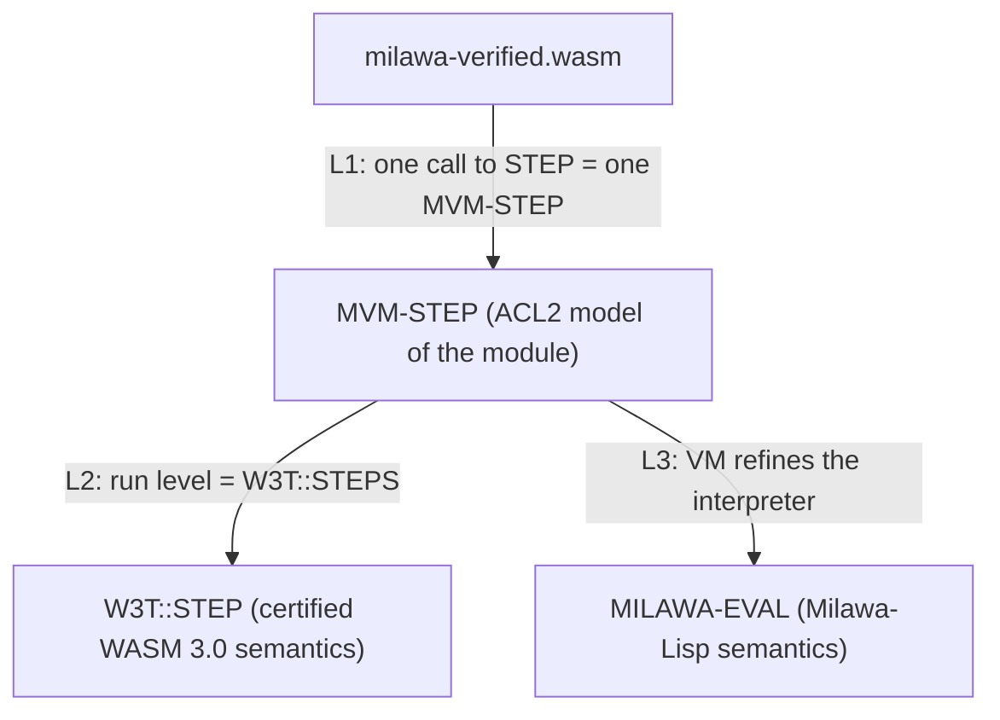

# milawa-verified-wasm — one page for reviewers

**Goal.** The sentence Milawa's `README` uses for Jitawa, with ACL2 for HOL4 and
WebAssembly for x86-64:

> if you run the simplified Milawa kernel on `milawa-verified.wasm` inside any
> conforming WebAssembly engine, it can only accept theorems of formulas that are
> semantically true.

**Shape.** Verify an *interpreter*, not a compiler.  `core.admit-defun` in
`milawa2.lsp` only records `(name formals body)` in a function table, so the
checker never calls a compiled definition; an interpreted function table
suffices, and the proof is O(size of the runtime) rather than O(size of the
kernel).  Three layers, each separately meaningful:



## What is proved (36 books, no `skip-proofs`, no `defaxiom`)

| Book | Content |
|---|---|
| `milawa-lisp/values.lisp` | value domain, 12 primitives, `2^30`-bounded arithmetic that aborts on overflow |
| `milawa-lisp/eval.lisp` | `MILAWA-STEP` (one step, total) and `MILAWA-RUN` (one tail-recursive fuel loop) |
| `milawa-lisp/programs.lisp` | kernel functions as data, in core syntax |
| `milawa-lisp/demo.lisp` | executable checks: rank, lookup, `ord<`, overflow, fuel exhaustion |
| `milawa-lisp/metatheory.lisp` | fuel monotonicity; abort/acceptance disjointness; zero fuel aborts |
| `milawa-lisp/reachability.lisp` | `MILAWA-RUNS`: exact step count, the two inference rules, positivity, shape, and that it agrees with `MILAWA-RUN` both ways |
| `machine/mvm.lisp` | `MVM-STEP`/`MVM-RUN`: the ACL2 model of the module, 32-bit words, status protocol.  A stopped machine is a fixed point; spending a budget in two instalments is spending it at once; **fuel monotonicity** — once it has stopped, a larger budget changes nothing |
| `machine/examples.lisp` | the example corpus: ten programs, each with the answer the artifact actually gives (recorded in `examples/*.mvm` from Node), proved about the model by evaluation — so the corpus is a test of the artifact and a proof about the model, kept separate on purpose |
| `machine/mvm-tests.lisp` | model vs module on a spread of programs — **tests, not proofs**, and labelled so |
| `wasm3/links.lisp` | **the links**: the second step of function 6's body at the flat, label and frame levels, plus `step-body-6-two`, which steps the machine twice and shows the two links genuinely compose |
| `wasm3/frozen.lisp` | **the frozen path, end to end**: the nine steps from `mvm-abs-abstract` when the status is not 1 -- the call, the read, the comparison, the branch, the block, the read inside the block's label, the two returns -- each at the callee's store and through the frame and the two labels, composed into the exact clock: nine fuel spends the nine steps and a tenth reports the stopped configuration, which is the abstract store unchanged with the status pushed into the caller's instruction list; and the readback, `milawa-observations` of that configuration against `(mvm-step st)`, with the stack words through the append form of the stack image.  `frozen-step-check` is `abs.lisp`'s `(milawa-step-check 9 st)` clause for clause, with the state symbolic |
| `wasm3/running.lisp` | **the running branch's shared head**: for a running status (1), the seven steps every running path takes before the dispatch -- the status test's else branch, the empty block and its label (both dissolve), the call split, and the call into `$in_code`'s frame.  `$in_code`'s body sits at the head of the new frame's label, with the rest of function 6's body after it.  Seven top-level links, each with its ctxt/label/frame wiring; the clock composition is the frozen path's and is left to the per-path proofs.  The first instruction of `$in_code`'s body is then stepped (`running-step-eight`), and the range facts the dispatcher needs are proved: the spec's i32 binops are `rem`s (`binop-sub-value`, `binop-mul-value`) and the comparison's value is 0/1 (`relop-ltu-value`) |
| `wasm3/dispatch.lisp` | **the callee's tail and the in-code dispatch**: `$in_code`'s body end to end at symbolic `pc`/`clen` -- the sub, the read of global 2, the mul, the comparison (the LAST instruction, so stepped by the pure `r-relop` rule), and the two value dissolves (label 3, then frame 3) -- each lifted through the search, label 3, frame 3, label 6 and frame 6, ending with the comparison's result pushed into function 6's continuation.  Then, under the in-code hypothesis (the comparison is 1, so the testop's value is the concrete 0): the opcode test, the second ifelse, the empty block/label dissolve, and the opcode fetch's first instruction (`global.get 1`).  78 events, 213,919,714 prover steps, 210.0s |
| `wasm3/numerics.lisp` | **the numeric bridge**: the spec's little-endian byte functions against the image.  `(mvm-word-to-bytes w) = ($le-bytes 4 w)` (loghead/logtail to mod/floor, nested floors flattened), `($le-int ($le-bytes 4 w)) = w mod 2^32`, `%u` on a 32-bit word, and both directions of `$nbytes_`/`$inv_nbytes_` at i32 (the load rule's value and its guard).  12 measured events, 25,359 prover steps |
| `wasm3/load.lisp` | **the opcode fetch and the first frame write**: the `i32.load` of the opcode (the READ rule `Step_read/load-num-val`, whose guard is the numeric round trip and whose in-bounds hypothesis `(<= (+ pc 4) (len bytes))` is what rules out the TRAP branch), then `local.set 0` (the WRITE rule `Step/r-local.set`, storing the opcode in the callee frame's local 0), both lifted through the context rules, label 6 and frame 6.  The local.set chain is stated over a generic store-and-frame pair `z`, which is what keeps the label/frame lifts cheap and matchable.  15 events, 8,493,949 prover steps, 10.8s |
| `wasm3/fetch.lisp` | **the next fetch instructions**: the second `global.get 1` (pc, read through the updated callee frame), then the add `pc + 4`, the `global.set 1` write of pc, and `local.get 0`.  The `(const 4)` is not a step of its own -- the semantics represents a stack constant by the same `(:CONST nt c)` list as the instruction, so the add's pure rule consumes both leading value-consts in one step.  The global.set is a store write through `$with_global`; its slice chain is the local.set's (lone failure, context failure, slice) and its value must stay opaque (`dadd`) or the rem expression enters the search's measure.  The local.get reads the updated frame's local 0 through `$local`; its slice is stated for a variable pair with a `$local` equality hypothesis, because the store is now a `$with_global` term that a spelled-out rule cannot match.  The frame lift keeps `$local`/`$sof`/`$fof`/`$with_global` disabled: 4.6M steps instead of 43M.  30 events, 15,649,761 prover steps, 17.2s |
| `wasm3/search.lisp` | the search's **failure** facts (an instruction missing its operands is not stepped) and the second body position; the book that explains why the search finds an instruction to run at k = 0 every time in this body |
| `wasm3/size.lisp` | `%SIZE` is `acl2-count` behind an `mbe`, plus the monotonicity the context rules' measure conditions need -- the bridge every descent lemma rests on |
| `wasm3/chain.lisp` | **generated, the bottom of the chain**: the body of function 6 as a literal, and its first instruction stepped — `step/r-ctxt-instrs` of `(:;% z BODY)` giving the value followed by the rest of the body.  A rewrite rule cannot match a literal, so this is an instance, and the generator emits it |
| `wasm3/head.lisp` | **the assembly layer**: a whole `step` of a one-instruction configuration (`step`, `step/r-read`, and the three forms of the head rule, the most general of which takes the instruction's own step as a hypothesis), the abstract store's reconstruction from its two halves, and the one piece of list arithmetic the semantics' search needs |
| `wasm3/memory.lisp` | the L1 memory correspondence: an MVM state's image in the module's memory (32-bit little-endian words, stack below 4096, code above), with the round trip `bytes-to-word (word-to-bytes w) = w` for 32-bit words **and at region level — decoding a word list's image gives the word list back** — image lengths, the disjointness invariant, and **the i-th word of an image**: `(take 4 (nthcdr (* 4 i) image))` is the i-th word's bytes for `i < len` (`image-word-at`) |
| `wasm3/returns.lisp` | **layer 7**: returning — out of the label, then out of the frame, leaving the callee's result |
| `wasm3/calls.lisp` | **layer 6**: the call rule — the entry configuration steps to a frame-and-label admin around the artifact's own code, with the locals zero-initialised |
| `wasm3/context.lisp` | **layers 4 and 5**: the context rules — a step inside a `:LABEL_` and inside a `:FRAME_` are steps of the body, re-wrapped; the composition law the library rests on |
| `wasm3/frames.lisp` | **layer 3**: `local.get` of all four locals with the frame symbolic — the layer every opcode's operand load goes through |
| `wasm3/reads.lisp` | **layer 2**: `global.get` of all five globals in the abstract store — the first place the store is symbolic in a proof |
| `wasm3/instructions.lisp` | **layer 1 of the instruction library**: ten `STEP_PURE` lemmas with symbolic values — five i32 binops, four comparisons, the zero test — stated at the static value count so the rule chain evaluates; the first place here where a symbolic state is stepped rather than evaluated |
| `wasm3/symbolic.lisp` | the abstraction a *symbolic* proof wants: the same store with the memory bytes a variable, the two lookups proved (field lookup on symbolic leaves, and the memory reading back as given), and the layering the instruction library follows |
| `wasm3/abs.lisp` | the abstraction itself: `MVM` state → entry configuration of a call to the exported `STEP`, through the spec's own `$WITH_MEM`/`$WITH_GLOBAL`, and the inverse observations. **Sixteen theorems, one per path through the module** — every opcode, every abort, both frozen statuses — each giving the exact clock and the fact that what the semantics stopped on reads back as `MVM-STEP` |
| `wasm3/l1.lisp` | the certified semantics executes the artifact: entry configuration is a call to function 6 with no arguments, `STEP` applies and is single-valued, three steps apply, one step enters the frame |
| `wasm3/bytes.lisp`, `module.lisp`, `state.lisp` | **generated** from the `.wasm`: the memory image, the module record, and the pinned store and frame.  Scripted rather than proved, because decode and instantiate are `:program` mode |
| `wasm3/decode.lisp` | the artifact decodes completely and instantiates with no externs (scripted, since the decoder and the instantiator are `:program` mode); the module is pinned as a logic constant; its shape, export names, and the fact that `STEP` is function 6 are theorems |

## The example corpus

`examples/*.mvm` is the lower-level stand-in for a Milawa events file: ten programs
with the answer each must give.  Each file holds the program as MVM words and an
`expect:` line that is **recorded from the artifact**, never written by hand —
`harness/examples.py --record` runs `wasm/milawa-verified.wasm` in Node and writes
the line.  `machine/examples.lisp` (generated by `--gen-lisp`) then **proves** the
model gives the same answer, by evaluation.

| Example | Program | Answer |
|---|---|---|
| `if-lt-true` | `(if (< 1 2) 10 20)` | halted, 10, 6 steps |
| `if-lt-false` | `(if (< 2 1) 10 20)` | halted, 20, 6 steps |
| `arith` | `(+ 20 (- 3 1))` | halted, 22, 6 steps |
| `sum-1-to-5` | `(+ 1 (+ 2 (+ 3 (+ 4 5))))` | halted, 15, 10 steps |
| `sub-wraps` | `(- 0 1)` | halted, **4294967295**, 4 steps |
| `lt-signed` | `(< -1 0)` | halted, 1, 4 steps |
| `jmp` | JMP over a `CONST` | halted, 7, 3 steps |
| `unknown-opcode` | opcode 7 | aborted, 1 step, PC 1 |
| `const-truncated` | `CONST` with no immediate | aborted, 1 step, PC 1 |
| `halt-empty-stack` | `HALT` with an empty stack | aborted, 1 step, PC 1 |

So a passing corpus means *the artifact does X* (a test, in Node, through a host we
do not trust) **and** *the model does X* (a proof, by evaluation).  The sentence
that ties the two together — that they agree for all inputs — is L1, still open.
Keeping the two claims separate, and both checkable, is the point: when L1 lands,
these same ten files become its regression suite.

Two of them earn their place by disagreeing with the obvious guess: `sub-wraps`
because `(- 0 1)` is `#xFFFFFFFF` and the harness has to report it **unsigned**
(JS exports an `i32`, so it prints `-1` unless asked not to), and `lt-signed`
because `#xFFFFFFFF` is the largest unsigned word yet is *less than* zero under
`i32.lt_s`.

`wasm/milawa-verified.wat` is the module: hand-written, one exported `STEP` per
machine step — the granularity of `MILAWA-STEP` and `W3T::STEP`, so no layer has
to reason about a loop.  It runs in Node today (`node harness/run.js`).

## Trust inventory

| Trusted | Why |
|---|---|
| ACL2 and its host Lisp | already trusted by Milawa's stage-1 proof |
| SpecTec + the SpecTec→ACL2 translator | generated semantics; no theorem connects output to source |
| the WebAssembly engine | the role the CPU plays in Jitawa |
| the front end and the I/O shim | can only cause a rejection, never a false acceptance |
| **one execution of the certified binary decoder, and one of the instantiator**, to turn the `.wasm` into the module and store constants | `W3T::GRAM/BMODULE` and `W3T::$INSTANTIATE` are `:program` mode, so neither step can be a theorem; both are scripted and checked (`harness/gen_module.py --check`).  Everything after them — `$INVOKE`, `STEP`, `STEPS/%FUEL`, `MODULE-P` — is `:logic`, so L1 and L2 are statable |
| WABT (`wat2wasm`) | untrusted by construction: a buggy assembler can produce a module that fails the proof, never one that passes it |

Not trusted: the evaluator, the primitives, the heap, the compiled runtime, and —
once `kernel/` exists — the correspondence between the kernel program and
`logic.proofp`.

## Four findings worth passing on

1. **`definductive` gives an elimination principle you cannot afford.**  It admits
   the predicate over a proof object, so the generated scheme's step case is
   stated in terms of `-PROOF-KIND` and `-PROOF-STEP->C2`, not the rule premises;
   the only route back is the `ALT` rule, whose functional instantiation
   re-proves the source theorem by induction on that proof object.  Measured:
   >16 min, unfinished.  Stating the rules *as a function of the exact step count*
   gave the same theorems in **0.2 s** and the halt/step induction a refinement
   proof actually wants.
2. **A `mutual-recursion` clique gets no induction machine**, so an evaluator
   written as `eval`/`eval-args`/`eval-application` is a dead end for metatheory.
   The single tail-recursive loop is what makes the metatheory reachable.
3. **"Exactly N" ≠ "at most N".**  A relation defined from the fuelled loop says a
   halting machine runs in any larger count; a WASM `STEP` derivation gives an
   exact count, so the count must be spent.  And completeness must exclude fuel
   exhaustion, or the theorem is simply false (ACL2 found it).
4. **Keep the machine step symbolic.**  Expanding `MILAWA-STEP` (20 branches) or
   `MILAWA-CONF-STEP` in a symbolic proof turns one subgoal into ~150; every hard
   proof here depends on disabling it and matching the hypothesis instead.

## The abstraction, and the clock

`mvm-abs` turns an MVM state into the configuration the certified semantics runs:
the artifact's own store, with the stack image written below byte 4096 and the
code image above it, and five globals set — SP (byte offset), PC (byte address),
CODE-LEN, STATUS, RESULT.  Those five and the memory under SP are the module's
whole mutable state, so `milawa-observations` reads a stopped configuration back
as machine state.

With the abstraction fixed, the clock is a fact rather than a parameter.  One
machine step is **47 to 101 spec steps, and the count depends only on the
opcode**:

| Path | Spec steps |
|---|---|
| status already 0 or 2 (frozen) | 9 |
| PC off the end of the code | 26 |
| HALT with an empty stack (abort) | 47 |
| HALT, one or two values | 53 |
| CONST | 67 |
| CONST with the immediate off the end (abort) | 55 |
| ADD / SUB / LT | 96 / 101 / 101 |
| ADD with fewer than two values (abort) | 63 |
| IFZ taken / not taken | 99 / 95 |
| JMP | 78 |
| unknown opcode (abort) | 63 |

That the clock does not depend on the *values* is what makes the symbolic proof's
clock a small case split rather than a search, and it is why `abs.lisp` is the
template for L1 proper rather than a detour.  Two of the numbers are worth
reading twice: an unknown opcode is cheaper than a known one (63 < 96) because it
falls out of the dispatch chain straight into `$abort`, and a truncated `CONST`
is cheaper than a good one (55 < 67) because it aborts before pushing.

Two things about the spec's API that cost time and are now written down in the
book:

- `$WITH_MEM` and `$WITH_GLOBAL` take the store-**and-frame** pair `Z`, not a
  store: `($SOF Z)` is the store and `($FOF Z)` the frame, and the module's index
  vector — the thing mapping a module global to a store slot — lives in the
  *frame*.  A store alone cannot be updated.
- the frame `$INVOKE` builds does not answer `%GET-FIELD :MODULE`, so the
  observers read the store through the pinned frame.  That is sound and is what
  we want: the module is a constant of the artifact and only the store varies.

### What the symbolic version actually hits

Four measured attempts.  The negative results are the useful part: the obstacle
is not where the plan assumed, and one of them dissolved on measurement.

**(a) The whole 9-step frozen-status chain, no hints.**  It does not even start:
the goal comes back *unreduced*, with `STEPS/%FUEL`, `STEP` and `$INVOKE` still in
it.  ACL2 will not unfold a recursive definition on symbolic arguments unless
asked.  A hint problem, not a cost problem — so the earlier "900 s and no output"
run was not measuring the chain either.

**(b) The whole chain with `(enable w3t::step)`.**  Killed at 400 s.  (One step
*with* `step` enabled is the same 0.13 s and the same failure as (c), so enabling
it is not the lever either.)

**(c) One single step, no hints.**  The rewriter *does* expand `$INVOKE`,
`$WITH_GLOBAL`, `%GET-FIELD`/`%PUT-FIELD`, `EXPAND` and the module's own lookups,
so a configuration with concrete shape and symbolic leaves is tractable; it walks
down `STEP`'s rule chain and stops at `STEP/R-CTXT-INSTRS` — the rule that steps
*inside* an instruction sequence.  It fails in 0.13 s and 29k prover steps, cheap
enough to iterate on.

**(d) The context-rule guard, measured.**  I first read (c) as "the `%SIZE`
guard in the context rules needs context lemmas".  That was wrong, and the
measurement is in `wasm3/size.lisp`: the module's WASM code lives in the store's
`:CODE` field, which neither `$WITH_MEM` nor `$WITH_GLOBAL` touches, so **every
instruction list in a configuration is concrete**; only the memory bytes and the
five globals are symbolic.  And the split point the context rules search for is
decidable on a concrete instruction list:

```
(step/prefix7 '((:GLOBAL.GET 3) (:CONST (:I32) 1) ...))    = 0
(step/prefix7 '((:CONST (:I32) 7) (:RETURN)))              = 1
(step/prefix7 '((:CONST (:I32) 7) (:CONST (:I32) 9) ...))  = 2
```

So the `%SIZE` guard — which mentions only the instruction list — evaluates too,
and the strict size lemmas are **not** on the critical path.  They are in
`wasm3/size.lisp` anyway (with the bridge that `%SIZE` is `acl2-count` hidden
behind `mbe` and disabled), because they are cheap and true and would be what an
arbitrary-program statement needs.

So the remaining blocker for a symbolic step is (a)+(b): `STEP` is a chain of
`(let ((r (STEP/R-X c))) (if r r (next)))`, and on a symbolic configuration ACL2
cannot decide any `STEP/R-X`, so the proof splits on each in turn instead of
walking the chain.  The residual goal of the single step says so exactly:

```
Subgoal 2
(IMPLIES (W3T::STEP/R-CTXT-INSTRS <config>) ...)
```

The lever is therefore not to enable `STEP` (measured: no difference) but to
enable **one `STEP/R-X` at a time** and feed its recursive call from the previous
lemma.  Concretely, the recipe for one instruction is:

1. state the successor as an explicit term, so nothing is invented at proof time;
2. `:in-theory (e/d (step/r-<that-rule>) (w3t::step))` — unfold only the rule, so
   the inner `STEP` stays symbolic and becomes the *hypothesis* rather than a thing
   to evaluate;
3. discharge that inner `STEP` with the lemma proved at the previous instruction,
   by `:use`, i.e. compose the chain by hand instead of asking ACL2 to run it.

That is an instruction-lemma library with the recursion factored out, and it is
the same object the engine's E4 builds — arrived at from the other direction.

**(e) The abstraction with an abstract memory.**  `wasm3/symbolic.lisp` restates
the abstraction with the memory bytes a variable instead of the pinned page, and
proves the two facts a symbolic proof needs first: that a field lookup on a store
with symbolic leaves is decidable (`%GET-FIELD` is `assoc-equal` on keys, and the
keys are concrete — the probe that "failed" had written `(list :globals g)` where
the store uses `(:globals . g)`, so it was the probe that was wrong), and that the
memory field reads back as the variable it was given.  With the page abstract, the
failing step leaves **one readable subgoal** instead of a screen of memory:

```
Subgoal 2
(IMPLIES (W3T::STEP/R-CTXT-INSTRS <configuration>) ...)
```

That is the rule which steps *inside* an instruction sequence.  ACL2 asserts it
rather than evaluating it, because evaluating it needs `(STEP <inner config>)`, and
the inner configuration carries the symbolic store, so `STEP/SEARCH21`'s walk down
the instruction list cannot bottom out.

### Layer 4: the context rules

The context rules are where the proof first reasons about *nesting*: a step inside a
`:LABEL_` or `:FRAME_` admin is a step of the whole configuration.  Measured, on the
smallest such statement — "stepping a config whose only element is a `:LABEL_`
wrapping one `local.get` is stepping the body and re-wrapping it":

- ACL2 leaves the goal as `(IMPLIES (W3T::STEP/R-CTXT-INSTRS <config>) ...)` and
  gives up in 215 prover steps;
- `:in-theory (enable w3t::step/r-ctxt-instrs w3t::step/prefix7
  w3t::step/search21)` changes nothing — the *same* 215 steps.

The reason, from `:pe`: these functions carry

```lisp
(declare (xargs :ruler-extenders :all
                :measure (wrt::%om3 (wrt::%size (nth 2 %a0)) (1+ (wrt::%size (list %a0))) 0)))
```

`:ruler-extenders :all` plus a `%SIZE`-based measure means the rewriter will not
open the definition unless the measure provably decreases at each unfolding — so
`enable` is the wrong lever entirely, and no amount of it helps.

The lever is **`:expand`**: force one unfolding of the rule function for the specific
term, let its concrete guards reduce, and expand the level beneath it with a `:free`
pattern.  `wrt::%size` is `acl2-count` behind `mbe` and disabled, which is what
`size.lisp` supplies.

**It works.**  `wasm3/context.lisp` proves two lemmas:

- `no-ctxt-instrs-on-a-lone-label` — the *negative* fact that has to come first: on
  a configuration whose only element is a label, `ctxt-instrs` does not apply.  242
  prover steps, two `:expand` hints.
- `step-in-label-local-get` — the context lemma itself: a step inside a `:LABEL_` is
  a step of the body, re-wrapped.  61,409 prover steps.
- `no-ctxt-instrs-on-a-lone-frame` / `-label-general` — the same negative fact for a
  frame, and generalised in the body, 458 prover steps each, which is what the
  deeper lemmas need.
- `step-in-frame-local-get` — **layer 5**, the nesting a call actually uses:
  `(frame n F (label k nil body))`.  14,310 prover steps.

The frame rule's bookkeeping is not symmetric and is worth having written down: the
inner configuration it steps is `(:;% (:;% S F') instr*)` — the store with the frame
carried by the *admin*, because that is whose locals the body reads — while the
result carries the *outer* frame, `(:;% (:;% S' F) ((:FRAME_ n F'' instr'*)))`.  Store
updates flow outward, frames flow inward; a lemma that swaps them is false rather
than hard, which ACL2 will simply refute.

That second one is the composition law the instruction library rests on: it is what
lets a chain of single-instruction lemmas be lifted out of the nesting.  The other
three context rules have the same shape; `ctxt-frame` is the one a call needs.

### Layer 6: entering a call, proved

`wasm3/calls.lisp` proves both halves:

- `no-ctxt-instrs-on-a-call` — 37,304 prover steps.  With `(:REF.FUNC_ADDR 6)`
  counting as a value (prefix7 = 1), the ctxt-instrs rule still does not apply to a
  call; measured before it was proved (`ctxt-instrs` NIL, `call_ref-func` T).
- `step-call-enters-frame` — 85,194 prover steps.  The entry configuration steps to

  ```
  (:;% Z ((:FRAME_ 1 F ((:LABEL_ 1 nil BODY)))))
  ```

  with `Z` unchanged, `F` the callee's frame with its locals zero-initialised, and
  `BODY` the callee's code taken out of the store's `:CODE` field.  The right-hand
  side is built by `milawa-callee-admin`, which is a *definition* rather than a
  literal because the body is two hundred lines; it was verified against the
  artifact by evaluation before any proof was attempted.

That is the whole entry path: layers 1-3 say what the body's instructions do, 4-5
lift a step out of the label and frame, and 6 puts the frame there in the first
place.

### Layer 7: returning, proved

`wasm3/returns.lisp`.  Both return rules are in `STEP_PURE`, because both
manipulations happen inside the *instruction list* -- the frame and label are
admins that appear in it, so unwrapping them needs no store at all.  Traced on the
shape a call produces:

```
((:FRAME_ 1 F ((:LABEL_ 1 nil ((:CONST 1) (:RETURN))))))   start
((:FRAME_ 1 F ((:CONST 1) (:RETURN))))                     label gone
((:CONST 1))                                               frame and return gone
```

- `step-pure-return-out-of-label` — the label is dropped, body kept whole.
- `step-pure-return-out-of-frame` — frame and `:RETURN` both go, leaving the
  callee's result.  The frame's arity is pinned to 1, which is the module's own
  arity (`step` returns one i32).

Three hypotheses emerged one at a time from ACL2's checkpoints rather than from
reading the rule: the label's type field is a `true-listp`, and the returned value
is `(unsigned-byte-p 32 x)` — which is *exactly* the rule's own guard,
`(and (integerp x) (<= 0 x) (<= x 4294967295))`, and also exactly what an i32
constant is.

### Why the library stays per-instruction

The obvious next move after layers 4-7 is to generalise the context laws: "if the
body steps to `inner`, the label steps to `inner` re-wrapped", with the body a
variable.  Measured: **400 s, killed**.  The reason is the same one that shaped the
whole library: the context rule has to *find* the split point in the instruction
list (`STEP/PREFIX7`, then `STEP/SEARCH21` walking k down), and with a symbolic body
that search cannot bottom out — so the rule cannot be shown to apply.

That is not a setback, it settles a design question.  Since the module's bodies are
**constants of the artifact**, every lemma the chain needs can be stated about a
concrete instruction list with symbolic *values*, which is exactly the shape layers
1-3 use and the shape that works.  A general law would be elegant and is not needed:
the chain is over `(milawa-func-body i)`, and `i` is fixed.

So the opcode theorems are built by specialising, and the work is mechanical: one
lemma per *instruction of the module's body*, at its static stack height, plus the
context wrapper from layers 4-7.  The measured clock per opcode (9 for a frozen
status, up to 101 for SUB) is the number of links in that chain, and it is now
visible: tracing the frozen path gives exactly

```
9: ((:FRAME_ 1 F ((:LABEL_ 1 is0 BODY))))     after the call
8..2: the same shape, stepping inside the label
1: ((:CONST i32 0) (:RETURN))                 inside the frame
0: ((:CONST i32 0))                           the value, frame gone
```

— one call, six steps inside, and two returns.

### How `step` descends, and the trick that unfolds it

Attacking the chain's first link produced the most useful structural result of this
stretch, and corrected a wrong assumption.

**Wrong assumption.** I had assumed `step/r-ctxt-instrs` is NIL on a config whose
instruction list is flat, so that the descent would fall through to the pure and
read rules.  It is not.  Reading the generated semantics
(`4_3-execution_instructions.lisp`) settles it:

```
(defun step/r-ctxt-instrs (a0)
  ... (let* ((%t9 (step/prefix7 %t6)))          ; leading values
        (and (< %t9 (len %t6))
             (step/search21 %t9 0 %t9 %t6 %t9 z a0))))
```

`step/prefix7` counts the leading values, then `step/search21` walks `k` *down*
from that count, and at each `k` it takes one instruction, wraps it in a
context-free config and calls `step` on it.  So `step/r-ctxt-instrs` is the
function that **finds the instruction to step next** and puts the surrounding
values back with `append`:

```
(:;% z' (append (step/iter20 values) (append instrs' rest)))
```

That is the mechanism the whole `step` rests on, and it means an instruction lemma
of the layer-1/layer-2 shape (values before, instruction last) is exactly what
`step/ctxt-instrs` consumes.  The layers built earlier are therefore the right
ingredients -- the chain does not need a separate interface.

**The descent for a frame holding a label.**  With `C0 = (:;% Z ((:FRAME_ 1 F ((:LABEL_ 1 nil BODY))))`,
one step is

```
step C0
  step/r-pure C0            -> nil
  step/r-read C0            -> nil
  step/r-ctxt-instrs C0     -> nil        (frame is not a value; the inner
                                           step on the frame itself recurses)
  step/r-ctxt-label C0      -> nil        (the one element is a frame, not a label)
  step/r-ctxt-handler C0    -> nil
  step/r-ctxt-frame C0      -> fires: steps (:;% (:;% S F) ((:LABEL_ 1 nil BODY))) = C1
    step/r-ctxt-instrs C1   -> nil        (a lone label -- no-ctxt-instrs-on-a-lone-label-general)
    step/r-ctxt-label C1    -> fires: steps (:;% (:;% S F) BODY) = C2
      step/r-ctxt-instrs C2 -> fires: the head instruction is global.get 3,
                               so (step (:;% Z1 ((:GLOBAL.GET 3)))) must give the
                               value, and the result is the value appended to BODY's tail
```

Three nested `step` calls, two inner nil-ness facts (both already proved), and one
per-instruction fact (the value of `global.get 3`, proved in `reads.lisp`).

**The trick: `:expand` cannot unfold a mutual-recursion member, a `:definition`
instance can.**  `step`, `step/r-ctxt-instrs`, `step/r-ctxt-label`,
`step/r-ctxt-frame` are one mutual recursion, so `:expand ((w3t::step C0))`
unfolds `step` and then *stops dead* at `(step/r-ctxt-frame C0)` -- adding
`:expand` for that symbol, or enabling its definition rule, changes nothing at
all (measured: 23,319 prover steps in every variant, byte for byte).  What works
is to instantiate the definition axiom by hand:

```lisp
:hints (("Goal" :use ((:instance (:definition w3t::step/r-ctxt-frame)
                                 (w3t::%a0 C0)))))
```

Measured: 496,961 prover steps with `z` a variable (stalls asking `(CONSP Z)`),
and with the real store `(mvm-abs-z-abstract bytes sp pc clen status result)` the
proof carries all the way to a single remaining obligation:

```lisp
(implies (< 21 (+ 27 (acl2-count f)))   ; the %OM3 measure side condition
         (w3t::step/r-ctxt-instrs <config at C2>))
```

So the chain is now a finite, enumerated list of obligations rather than a black
stall -- which is the first time that has been true.  The next steps are: the
head-instruction lemma for a flat config (`step/r-ctxt-instrs` on
`(:;% z (cons instr rest))`), and the `%size`/`acl2-count` facts that discharge
those `(< 21 (+ 27 (acl2-count f)))` side conditions -- what `size.lisp` began.

## The head rule: the load-bearing lemma of the chain

`wasm3/head.lisp` is new and it holds the lemma the whole chain is built on --
stepping the *first* instruction of a flat configuration:

```lisp
(defthm ctxt-instrs-steps-the-head
  (implies (and (consp rest)
                (true-listp rest)
                (equal (w3t::step (list :|%;%| z (list (list :global.get 3))))
                       (list (list :|%;%| z
                                   (list (list :const (list :i32)
                                               (milawa-global 3 z)))))))
           (equal (w3t::step/r-ctxt-instrs
                   (list :|%;%| z (cons (list :global.get 3) rest)))
                  (list (list :|%;%| z
                              (cons (list :const (list :i32) (milawa-global 3 z))
                                    rest))))))
```

302,816 prover steps.  `Z` is symbolic, so every position of every body is an
instance of it; the one-instruction step it needs is a *hypothesis*, which is what
makes a symbolic store possible at all (without it the search's inner step cannot
be reduced, because the answer would have to be phrased in the spec's record
structure).

Three things had to be discovered to get there, and each of them was a wrong
belief first:

1. **The search refuses a lone instruction.**  `step/search21` requires
   `(or (not (equal val-star nil)) (not (equal instr-1-star nil)))` -- a value
   before the instruction or an instruction after it.  A statement without
   `(consp rest)` is *false*, not merely hard, which is why the first attempt
   burned 401,630 prover steps chasing it.
2. **`acl2-count` of a cons is positive, and that is the only arithmetic needed.**
   `(defthm acl2-count-positive-when-consp (implies (consp x) (< 0 (acl2-count x)))
   :rule-classes :linear)` -- 381 prover steps, and it closed the measure
   comparison the search makes.
3. **The natural companion of that rule is FALSE.**  `(equal (equal (acl2-count x) 0)
   (not (consp x)))` does not hold in ACL2, because a symbol counts by the length
   of its name.  Stating it wasted a round; the one-directional linear rule is the
   right thing.

Also proved here, and needed to discharge the hypothesis above: `step` and
`step/r-read` on a one-instruction configuration over the abstract store, giving
the parameter `STATUS` back (21,668 and 21,597 steps).

**Where the first link actually stops now.**  Driving the whole thing through
`gen_chain.py` with the frame pinned to `(milawa-callee-frame 6)` and the inner
context pinned to `(list :|%;%| (car (mvm-abs-z-abstract ...)) (milawa-callee-frame 6))`
moved the stall one level *up*: the obligation is now

```lisp
(w3t::step/r-ctxt-instrs (:;% Z ((:FRAME_ 1 F ((:LABEL_ 1 nil BODY))))))
```

with a *concrete* frame `F`, where `Z` is a variable it proves in 19 steps.  The
reason is `%SIZE`: at `k = 0` the search wraps the frame itself and asks whether
`(%SIZE (nth 2 (list :;% z instr-star)))` is less than `(%SIZE (nth 2 a0))`, and
with `instr-star` produced as `(take 1 (nthcdr 0 instrs))` the two are equal in
value but not syntactically equal -- so ACL2 has to do arithmetic on
`acl2-count`s to see that the strict inequality fails.  That is precisely
`acl2-count-of-take` and `acl2-count-of-nthcdr`, which `size.lisp` already has;
what is missing is the obligation being stated in a shape those rules fire on.

So the remaining work for the first link is now three named things, in order:
(1) the `acl2-count`/`%size` step that makes the search's measure comparison go
through, (2) then the link itself, (3) then the same generator extended to the
body's other instructions.  Nothing about it is open-ended any more.

## The chain: the descent is proved, level by level

`wasm3/chain.lisp` (generated) now carries five lemmas, all certified:

| lemma | prover steps | what it says |
|---|---|---|
| `step-flat-body-6-first` | 145,059 | the body's first instruction steps, store pinned |
| `flat-body-6-general` | 683,415 | the same at an **arbitrary** store |
| `step-in-label-body-6-first` | 1,217,401 | a step inside a label, store pinned |
| `label-body-6-general` | 487,458 | a step inside a label at an **arbitrary** store |
| `frame-body-6-general` | 6,861,519 | a step inside a frame at an arbitrary store |
| `step-nil-on-a-lone-relop` | 12,860 | a comparison with no operands is not stepped |
| `step-nil-on-a-relop-with-one-value` | 17,475 | nor with one |
| `flat-body-6-second` | 69,354 | the second position: two operands consumed |
| `step-in-label-body-6-second` | 1,525,484 | the same inside a label |
| `step-in-frame-body-6-second` | 5,143,242 | the same inside a frame |
| `step-body-6-second` | 443,329 | **the second link**: two instructions of the body, verified |
| `step-body-6-two` | 178,686 | **the two links composed**: the machine advances two steps |

9,394,852 prover steps in **10.9 seconds**.  The largest proof in the project and
one of the cheapest to run; the ratio is worth keeping in mind before reading a big
step count as slowness.

Each level is an implication whose hypothesis is the level beneath it, so the ladder
composes:

```
instruction   (step (:;% z ((:global.get 3))))        -- head.lisp, store pinned
    |  flat-body-6-general          (:;% z BODY)
    |  label-body-6-general         (:;% z ((:LABEL_ 1 nil BODY)))
    v  frame-body-6-general         (:;% (:;% s f) ((:FRAME_ 1 f' ((:LABEL_ 1 nil BODY)))))
```

**Four rules for this kind of proof, all measured, all of which cost a wrong attempt
first.**

1. **Pass the lower level with `:use`, do not rely on it as a rewrite rule.**  As a
   rule it does not fire on the goal ACL2 actually builds.
2. **Disable `step/r-ctxt-instrs`.**  Without it the identical goal costs 288,294
   steps and stalls: the rewriter prefers to re-expand the search over using the
   lemma it has.  (Fourth time in this project that withholding a definition rule
   was the fix.)
3. **Do not disable the rule the level needs to apply.**  Disabling
   `step/r-ctxt-label` while proving the frame level costs the proof: ACL2 then
   still has to establish that the label rule applies and cannot unfold it to do so.
4. **Keep the pushed value concrete.**  With it symbolic the rewriter has to reason
   about `append` and the label level runs to 48.6M steps without finishing; with it
   written as `(cons (list :const (list :i32) status) (cdr *body-6*))` the same
   statement is 487,458 steps.

## Two consecutive links, and a lemma that was quietly useless

`wasm3/links.lisp` is new and it carries the **second link**: one more step of
function 6's body from the configuration the first link leaves behind.  Together
with `step-body-6-first` the chain now advances two instructions --
`(:GLOBAL.GET 3)` and the comparison's two operands -- with the store, the frame
and the label carried through.  Same recipe at each position, proved twice:

```
flat   -- which instruction runs, and what the search hands to `step`   (search.lisp)
label  -- the same step inside a label, re-wrapped                      1,525,484
frame  -- the same step inside a frame, re-wrapped                     5,143,242
link   -- the three composed                                              443,329
```

**The lemma that was quietly useless.**  An earlier `flat-body-6-second` stated the
second position with the inner step `(step (:;% z '((:const (:i32) 1))))`.  That
inner step is NIL -- a slice of one instruction with nothing before or after it is
refused by the search -- so the implication was **vacuously true**: it proved, and
it could never be applied.  A vacuous theorem is worse than a missing one, because
it looks like progress and stays in the tree.

What found it: `make walk --full` showed `step/prefix7` answers **2** at the second
position, because a `(:CONST ...)` reads as a value whether it is a pushed operand
or an instruction that has not run yet.  The search then tries k = 2, k = 1 (both
nil, by `search.lisp`'s two failure facts) and succeeds at **k = 0** with the slice
`(v1 v2 (:relop ...))`.  So the first two positions of this body are k = 0 and
k = 0, not k = 0 and k = 1 -- and the real lemma is the one that was misnamed
`flat-body-6-third` (now `flat-body-6-second` in `search.lisp`), the vacuous one is
deleted.

**And the links genuinely chain.**  Separately proved lemmas can be true and still
not compose, which is exactly what the vacuous lemma taught, so
`step-body-6-two` steps the post-call configuration *twice* --
`(car (step (car (step c))))` -- and checks the answer against what the second
link predicts.  178,686 prover steps, and it needed one more rule:

```lisp
:in-theory (disable w3t::step w3t::step/r-ctxt-instrs)
```

Without it the composition ran past six minutes without finishing, because the
rewriter tried to re-derive the steps instead of chaining the two equations it was
handed.  With `step` disabled the proof is propositional: substitute, match, close.
That is the fifth rule for this kind of proof, and the cheapest of them.

Two lessons worth keeping: **a theorem whose hypothesis can never be satisfied is a
bug**, and the way to catch one is to measure the inner step it assumes rather than
admiring that it proved.

**The third position, and what it took.**  `wasm3/search.lisp` is new: the two
*failure* facts the third position needs, which nothing in the tree had --

```lisp
(step (:;% z '((:relop (:i32) (:ne)))))                  = nil   ; no operands
(step (:;% z '((:const (:i32) 1) (:relop (:i32) (:ne))))) = nil   ; one operand
```

-- because the search walks k down from the value count and hands `step` the slice
`(take (- (+ 1 prefix) k) (nthcdr k instrs))`, so a comparison is only stepped at
k = 0, with both operands in the slice.  Without these facts, `flat-body-6-third`
fell into induction after 8,600 steps; with them it is 69,354 steps of ordinary
rewriting.

One hypothesis it also needed: `(unsigned-byte-p 32 status)`.  The pushed operand
has to be a real i32 or `(:CONST (:I32) status)` is not a value at all, and ACL2
case-splits on `(integerp status)` without it.  That is a fact about the module
being well-typed rather than a proof trick, and it belongs in the lemma.

**And the probe is what made any of this possible.**  `gen_chain.py --probe`
computes `step` on a concrete configuration and prints the answer, so each
right-hand side is read off the semantics.  It also settles questions cheaply: the
frame statement was verified TRUE by evaluation before it was proved, which is how
the "malformed configuration" hypothesis was ruled out instead of chased.  Every
one of the earlier attempts at these levels had a wrong configuration in a hint and
no way to know.

**What remains for L1**, and what the walk now says about it.  `make walk` iterates
`step` from the configuration a call leaves behind and prints the shape of each
step; `make walk --full` prints the whole instruction list, from which the
instruction sequence and the stack shape at each step can be read off:

```
step 0:  body head  (:GLOBAL.GET 3) (:CONST (:I32) 1) (:RELOP ...) ...   is0 = NIL
step 1:  body head  (:CONST (:I32) status) (:CONST (:I32) 1) (:RELOP ...)  <- value pushed
step 2:  body head  (:CONST (:I32) result) (:IFELSE ...)                   <- operands consumed
step 3:  body head  (:BLOCK_%{%}% (:_RESULT ...) ((:GLOBAL.GET 3) (:RETURN)))
step 4:  body head  (:LABEL_%{%}% ... (:GLOBAL.GET 3) (:RETURN) ...)
step 8:  head :CONST           -- the frame is gone
step 9:  stuck                 -- halted
```

Two things this settles, both of which change the plan:

1. **The first three steps are flat lemmas** -- one instruction, then one value
   pushed, then two values consumed -- and two of those are already proved
   (`step-flat-body-6-first`, `flat-body-6-second`).  The pattern is a per-position
   lemma with the values and the instruction as literals and `rest` symbolic.
2. **From step 3 the instruction list is no longer a flat body.**  Executing the
   `:IFELSE` introduces a `:BLOCK_`, and then a nested `:LABEL_`, so the remaining
   steps are *not* more flat lemmas: they are the block rule and the return rule,
   which is what layers 4-7 of the instruction library were built for.  Composing
   those into the chain is a different piece of work from the flat positions, and
   this is the first time that has been clear.

So the order for L1 is: the remaining flat positions (mechanical, generator
output), then the block and return steps using `returns.lisp`'s lemmas, then the
call (layer 6) to join the post-call configuration to the entry configuration
`abs.lisp` describes.

```
step 0..7:  ok=T  instrs = ((:FRAME_ ...))   head = :FRAME_%{%}%   store unchanged
step 8:     ok=T  instrs = ((:CONST ...))    head = :CONST         store unchanged
step 9:     ok=NIL                              (halted: nothing left to step)
```

-- so all eight inner steps have the *same outer shape*, the frame rule fires each
time, and the store never changes.  That means the chain is the general frame bridge
applied eight times, and the only thing that varies is the **flat** step inside the
label: which instruction is next, and how many values are already pushed.

The per-position flat lemma is proved for the first two positions
(`step-flat-body-6-first`, 145,059; `flat-body-6-second`, 131,043), and its shape is
the one that generalises: **instruction literal, `rest` symbolic**.  The general form
with the instruction symbolic needs `step/prefix7` to decide whether the head is a
value, which it cannot, and diverges past 10,489 subgoals.

So the remaining links are generator output: one flat lemma per body position, each
lifted by the general label and frame bridges.  One caveat found and not yet solved:
a *fully* general label bridge (`body` a variable, not the literal) stalls, so the
label instance should be emitted per position too, alongside its flat lemma.

Then the call (layer 6, `step-call-enters-frame`) and the two return lemmas (layer 7)
join them into the 9-step theorem that matches `abs.lisp`'s clock.

Then the call (layer 6, `step-call-enters-frame`) and the two return lemmas
(layer 7) join them into the 9-step theorem that matches `abs.lisp`'s clock.

## Bodies must be literals, not terms

The next thing tried was the chain's first link, stated compactly:

```lisp
(equal (step (:;% Z ((:LABEL_ 1 nil (milawa-func-body 6)))))
       (:;% Z ((:LABEL_ 1 nil (cons (:CONST i32 status) (cdr (milawa-func-body 6)))))))
```

i.e. "the body's first instruction reads the status global and pushes it", with the
two-hundred-line body hidden behind the accessor.  Measured: **229,292 prover steps
and it still stalls at the same `STEP/R-CTXT-INSTRS` question** — the rule's search
does not bottom out, because the body is now a TERM rather than a list it can walk.
The `no-ctxt-instrs-on-a-lone-label-general` lemma it needs does not match, and even
with the body opaque the search has nothing to work with.

Compare the same statement with the body written out as a literal: layers 1-5 all
proved that way, cheaply.

So the chain's lemmas must carry **literal** bodies.  (And having built the
generator — `harness/gen_chain.py`, which lifts function 6's body out of
`state.lisp` — the first literal-body link *still* stalls at the same
`STEP/R-CTXT-INSTRS` question.  So the literal is necessary and not yet sufficient:
what is missing is a way to tell ACL2 that the rule does not apply, and
`no-ctxt-instrs-on-a-lone-label-general` is not matching the term ACL2 produces.
That is the next thing to fix, and it is narrow: one rewrite rule's LHS.)  That is not a hardship -- it is
a generated artifact, exactly as `state.lisp` and `module.lisp` are: `harness/`
should grow a generator that reads the module's bodies out of the pinned store and
emits one lemma per instruction, at its static stack height, with the literal body
it belongs to.  The `milawa-func-body` accessors stay useful for stating THAT a body
is what we think it is (a drift check), not for hiding it inside a proof.

### The instruction library, cut at the joints

The residual names the first lemma, and the object is smaller than it looks: the
innermost pieces are *instruction lists*, not configurations.

```
step_pure : instr* -> instr* option     arithmetic, tests, consts -- no store
step_read : config -> instr* option     loads, global.get, local.get
```

So for one instruction the chain is

```
STEP_PURE lemma   (symbolic values only, no store)   <- DONE, wasm3/instructions.lisp
  -> STEP_READ lemma   (one store read at a concrete place)  <- DONE, wasm3/reads.lisp
     and the same layer reading the FRAME (locals)           <- DONE, wasm3/frames.lisp
    -> ctxt-label / ctxt-frame lemma   (one level of nesting)
      -> ctxt-instrs lemma             (the split point)
        -> the call rule               (entering and leaving a function)
```

each proved with **only its own rule enabled**, its recursive call discharged by
the lemma beneath it.

The first layer is proved: `wasm3/instructions.lisp` has ten lemmas — the five i32
binops and the four comparisons the module uses, plus the zero test — each about a
configuration with **symbolic values** and the value count at its static length:

```lisp
(defthm step-pure-binop-add
  (equal (step_pure (list (:const i32 c1) (:const i32 c2) (:binop i32 add)))
         (list (list (:const i32 (car ($BINOP_ i32 add c1 c2)))))))
```

3.7 s for the book; 3,788 prover steps for the first lemma.  The right-hand sides
are the spec's own operations, so nothing about 32-bit wrapping or signedness is
assumed — the lemmas conclude whatever the certified semantics concludes.  Two
shape facts worth having written down: `$BINOP_` returns a *list* (it can trap) so
the rule takes `(car ...)`, while `$RELOP_` and `$TESTOP_` return the value
directly; and `div_u` needs the trap not to fire, which is exactly the rule's own
guard.

Layer 2 is proved too: `wasm3/reads.lisp` covers `global.get` of all five globals
in the **abstract store**, so the store is symbolic in the proof — the five globals
arrive as variables and the semantics digs them back out.  12,101 prover steps for
the first one, and the reason it works is the fact `symbolic.lisp` established:
the lookup is `assoc-equal` on keys and the keys are concrete.  `global.get` is the
read that matters most, because the module's dispatch begins `(global.get $status)`
and every address goes through `(global.get $pc)`.

Layer 3 adds the frame: `wasm3/frames.lisp` proves `local.get` of all four locals
($op, $imm, $a, $b) with the frame's locals symbolic.  2,647 prover steps each —
cheap, because no global lookup is involved.  Every one of the module's seven
opcodes loads its operand word through those locals, so this is what makes the
dispatch expressible at all.

Two representation facts, both found by measuring and both of which answer NIL
silently when got wrong:

- **a local is a singleton list holding its value**: `(:LOCALS ((:CONST (:I32) 0)) ...)`.
  That is why the rule's value is `(CAR ($LOCAL Z X))` and why `$LOCAL` itself
  answers a list.  Written unwrapped, every lemma on this layer says NIL and it looks
  like the semantics has no `local.get` rule.
- **the config is `(:;% Z instrs)` with `Z` = `(:;% STORE FRAME)`.**  Passing the
  store where `Z` belongs also answers NIL, silently — the same trap `abs.lisp`
  records for `$WITH_MEM`/`$WITH_GLOBAL`, and it cost a second afternoon.  Then C2 per opcode is a chain of those — ~50 to 100 links,
exactly the clock in the table above, writable because the clock does not depend on
the values.

## Where L1 stands

The certified WASM 3.0 semantics **executes the artifact**, and that is proved, not
tested: `wasm3/l1.lisp` pins the instantiated store and frame as logic constants
and proves, by evaluation on them, that the entry configuration exists, that it is
a call to function 6 with no arguments, that `STEP` applies and is single-valued,
that three steps still apply, and that one step enters the frame pushed for our
function's locals.  Those are the first facts here stated about the certified
semantics running our module rather than about our model of it.

Getting there needed the API written down: `$INSTANTIATE` returns a
*configuration*, not a store (ours is already final, since the module has no
imports, data or start function); the store and frame are `(CADR (CADR C))` and
`(CADDR (CADR C))`; `$INVOKE` builds the entry configuration; `STEP` returns the
*list* of successors.

Two steps remain outside the logic: decode and instantiate are both `:program`
mode, so they are scripted and drift-checked (`harness/gen_module.py --check`)
rather than proved.  Everything after them is statable.

With `abs.lisp` the *statement* of L1 is fixed and checked on every path the
module has: sixteen ground theorems, each giving the exact clock, each showing
one more step is not available, and each showing that the configuration the
semantics stopped on reads back as `MVM-STEP`.  What remains is the same theorem
with the state symbolic — a symbolic execution of the module's twelve function
bodies.  That is the piece the `wasm-acl2` engine goes after as E11, and it is
unfinished there too (its C2 is proved for clock-0 steps only), so this is the
project's hardest open problem, not a formality.

`wasm3/frozen.lisp` is the first of the sixteen paths, done end to end.  For a
symbolic state whose status is not 1 -- the halted and aborted states -- it
proves the nine steps from the entry configuration to the stopped one, store
unchanged, the exact clock (`(steps/%fuel 9 ...)` is NIL, `(steps/%fuel 10 ...)`
is the stopped configuration), and the readback: `milawa-observations` of the
stopped configuration against `(mvm-step st)`, with the stack words going
through `milawa-words-of-word-list-image` and the append form of the stack
image.  `frozen-step-check` is therefore `abs.lisp`'s `milawa-step-check` with
the state symbolic.  The other fifteen paths are open, and their links are this
path's plus the call rule.

Underneath L1 proper sits the memory correspondence, and the hardest piece of it
is now proved: **decoding the image of a word list gives the word list back**
(`mvm-image-words-of-mvm-word-list-to-bytes`), and the stack case follows
(`mvm-image-of-stack`).  The route there is worth recording, because the obvious
statements do not work:

- the indexed form `(nthcdr (* 4 i) bytes)` is the natural thing to write and is
  unusable — `(* 4 i)` blocks every append lemma, and rewriting it to
  `(+ 4 (* 4 (i-1)))` makes ACL2's `fold-consts-in-+` fold it straight back, to a
  HARD ERROR [Call depth] 1000;
- letting the recogniser `mvm-word-list-p` unfold splits each induction step on
  `(integerp (car ws))`, `(<= 0 ...)` and `(< ... 2^32)`: 259, then 4963 subgoals,
  387 s and 56 GB before giving up;
- letting `mvm-word-to-bytes` unfold brings `loghead`/`logtail` in, and ACL2 then
  splits on the arithmetic: 9.5M prover steps, still open.

What closes it is all three together: a decoder that consumes four bytes a step
(`car`/`cadr`/`caddr`/`cadddr` instead of an index), a **step rule** about the
append form, and the recogniser plus the byte-level definitions **disabled** so
that forward-chaining supplies the recogniser's facts without ever unfolding it.
The induction then finishes in 0.48 s.

**The indexed word extraction is proved too** (`image-word-at`, 1,843 steps):
for `i < (len ws)`, `(take 4 (nthcdr (* 4 i) (mvm-word-list-to-bytes ws)))` is
`(mvm-word-to-bytes (nth i ws))` -- the lemma the i32.load positions need.  The
absolute-index induction this book's note warns about is avoided by inducting
lexicographically on `(i, ws)` together (`image-ind`) and stating the succ step
at the index `(* 4 i)` (`bytes-succ4`); that step's arithmetic `:use` instance
costs 1.41M steps, which is the price of the index rewrite, and the extraction
itself is 1,843.  The small append/nthcdr/take lemmas are 3,900 together.

## The frozen path: nine steps, end to end

`wasm3/frozen.lisp` is the first path through the module proved from the entry
configuration to the stopped one, for a symbolic state: status not 1 (the halted
and aborted states), a symbolic memory, a symbolic status.  It is the symbolic
form of `abs.lisp`'s `(milawa-step-check 9 st)` for a symbolic state, clause
for clause.  The steps, in order, and how each is proved:

| # | what runs | how it is proved |
|---|---|---|
| 1 | the call to function 6 | `step/r-call_ref-func`, by evaluation |
| 2 | `(global.get 3)` | the read layer, at the **callee's** store |
| 3 | the comparison against 1 | `step_pure`, plus the search's failures at k = 2, 1 |
| 4 | the `:IFELSE` | `step_pure/r-if-true` -- it rewrites the branch into a **block** |
| 5 | the block | `step_read/split/r-block` -- the block becomes `(:LABEL_ 0 NIL ...)` |
| 6 | the `global.get` inside that label | a second label level in the descent |
| 7 | the inner label's `:RETURN` | `step_pure/r-return-label` |
| 8 | the outer label's `:RETURN` | the same rule, with the body's tail dropped |
| 9 | the frame's `:RETURN` | `step_pure/r-return-frame` |

The composition is `frozen-path-ten` (`(steps/%fuel 10 ...)` is the stopped
configuration) and `frozen-path-nine` (`(steps/%fuel 9 ...)` is NIL): the two
halves of the exact clock.  The readback completes it: the five globals
(`frozen-globals-read-back`), the stack words (`frozen-memory-clause`, built on
`milawa-words-of-word-list-image`), and `frozen-step-check`, which is
`abs.lisp`'s `milawa-step-check` clause for clause with the state symbolic.
That is one of the sixteen paths, done.  Two things about it are worth
carrying forward.

**The block is a read rule and the context lemma was not needed.**  The plan
said the block step needed the general context-descent lemma because there is no
`step/r-ctxt-block`.  That was the wrong conclusion from a true premise: the
block rule is `step_read/split/r-block`, in the READ layer, reached through
`step/r-read` by the ordinary instruction search.  It rewrites `(:BLOCK bt
instrs)` into `(:LABEL_ n NIL instrs)` where `n` is the blocktype's result
count, and a lone block proves by evaluation in 516 prover steps.  The extra
label it creates is what makes steps 6-8 a two-label descent; that is a shape,
not a lemma.

**The chain had to be restated at the callee's frame.**  `links.lisp`'s links,
and the `make walk` configuration, use the pinned frame `(CADDR Z)` under the
label.  The call actually leaves `(milawa-callee-frame 6)`, whose four zero
locals make it a different term, and the body reads globals through its own
frame's module -- so the walk's configuration is a faithful shape, not the
actual term.  `frozen.lisp` states every link at the callee's store; the modules
are equal, so the same `global.get` lemmas go through, but the terms are not the
links' terms.  This is the same lesson as the vacuous second link: a lemma can
be true and not be the one the chain needs.

Three proof-engineering facts, all measured.  A lemma whose `status` occurs in
its result but not its input -- the inner-label steps, where the status arrives
only from the read -- has a **free variable** in its LHS as a rewrite rule, and
will not compose; binding it in the `:use` instance is the fix.  `steps/%fuel`
will neither evaluate nor unroll on a constant fuel with an opaque
configuration, so the clock is composed with one `:rule-classes nil` successor
lemma per step plus a definition instance, used through `:use` -- as a rewrite
rule the fuel-decreasing successor would loop, which is the same lesson as
`milawa-run-monotone`.  And a rewrite rule **can be applied to its own
right-hand side** by ACL2's arithmetic matcher: a shift fact about
`(nthcdr (+ 4 a) l)` matches the constant `4` with `a = 0`, so it rewrites
`(nthcdr 4 X)` into `(nthcdr 4 (nthcdr 0 X))` and grows.  `:brr` gives the
trace; the fix is `:rule-classes nil` plus `:use`, and -- for the readback --
the append form `(nth (+ i (len pre)) (append pre b)) = (nth i b)`, proved
through `nthcdr`, which is what made `milawa-words-of-word-list-image` go.

## The callee's tail: `$in_code`'s body end to end

`wasm3/dispatch.lisp` executes function 3's body from the configuration
`running.lisp` leaves, at symbolic `pc` and `clen`, and returns its result into
function 6's continuation.  The body is

```
(global.get 1) (const 4096) (binop sub)
(global.get 2) (const 4)  (binop mul) (relop lt_u)
```

so five instruction steps and two dissolves, under four admin levels (frame 6,
label 6, frame 3, label 3).  Each step is proved in the same seven parts, and
every part is a separate lemma:

| part | statement |
|---|---|
| `slice` | the instruction's own step on the exact slice the search hands it |
| `ctxt` | `step/r-ctxt-instrs` of the body, with the search's instances and failures |
| `step` | the bridge from the context rule to `step` |
| `label` | the same step inside label 3 |
| `frame` | the same step inside frame 3 (the ctxt-frame rule's inner config) |
| `body6` | the same step inside label 6 (the search's k = 0 slice) |
| `label6` | the same step inside label 6's label |
| `outer` | the same step inside frame 6 |

The shapes by position, which is the classification to do first:

| # | instruction | shape | body after |
|---|---|---|---|
| 2 | `(binop sub)` | search, k = 2, 1, 0; the k = 1 slice fails with one operand | two values and the rest |
| 3 | `(global.get 2)` | search, k = 1 only (the read needs no operands) | one more value |
| 4 | `(binop mul)` | search, k = 3, 2, 1; the leading sub value is skipped | the two operands consumed |
| 5 | `(relop lt_u)` | **pure**: the last instruction; the search's k = 0 refuses an empty rest | one value |
| -- | label 3 | `r-label-vals`: the body is a value list | -- |
| -- | frame 3 | `r-frame-vals`: one value, the frame's arity | -- |

The comparison is the case the earlier recipe did not cover: the flat
`step/r-ctxt-instrs` lemma for it is **false**, because the search refuses a
slice that is the whole instruction list, so the body is stepped by
`step_pure/r-relop` directly.  Its lift starts from that pure body step.  The
two dissolves are `step_pure/r-label-vals` and `step_pure/r-frame-vals`, each
then lifted through label 6 and frame 6 like any other step.

**The two mistakes that cost the most, both now in the traps list.**  The full
body at label 6 must be `(append (dadmin b) rest6)`, not `(cons (dadmin b)
rest6)`: `dadmin` returns a one-element *list* of instructions, and consing it
puts a list where the frame instruction belongs.  The malformed body still
steps (the search simply fails), but every context rule's measure then compares
the wrong lists, and the proof ends on false linear inequalities such as
`(<= (+ 22581 pc) (+ 17854 pc))`.  And `acl2-count` in this ACL2 charges an
integer its absolute value, so a symbolic `pc`/`clen` inside an instruction
list turns every `%SIZE` guard into arithmetic: `$BINOP_` is evaluated,
`numerator`/`denominator` terms appear, and the goal becomes `(<= 2^32 pc)`.
The fix is to keep the intermediate values as opaque terms with conditional
`:type-prescription` rules (`integerp-dsub`, `integerp-dmul`, `integerp-dltu`,
`integerp-testop-eqz`), so acl2-count sees `(integer-abs term)` on both sides
of each comparison.

**Measured costs** (prover steps, from `dispatch.cert.out`; 51 events, 207.5M
total, 227.8 s):

| event | steps |
|---|---|
| `dctxt-sub` | 14,808,852 |
| `dbody6-sub` | 11,920,649 |
| `douter-sub` | 2,150,669 |
| `dctxt-read` | 621,865 |
| `dbody6-read` | 16,253,650 |
| `dctxt-mul` | 70,519,188 |
| `dbody6-mul` | 19,514,795 |
| `dframe-ltu` | 5,256,128 |
| `douter-ltu` | 3,818,939 |
| `douter-label-dissolve` | 18,519,443 |
| `douter-frame-dissolve` | 17,080,791 |

The mul's context rule is the expensive one: three search positions, each with
its failure facts, and the value in the body.  The two dissolve `outer` lifts
are expensive for the opposite reason: the frame-6 measure has to see through
the whole body's 39-instruction continuation.  Neither blocks anything; the
book certifies in under four minutes.

**Where the opcode test stands.**  The in-code route is proved.  The running
path is the in-code case: the comparison's value is 1 (pc - 4096 is below the
code length), so `$TESTOP_` of it is the concrete 0.  Under the hypothesis
`(equal (dltu (dsub pc) (dmul clen)) 1)` the instruction lists are concrete at
every step and the standard recipe goes through: the search computation
(`dsearch21-eqz`, 141k steps), the context rule (101k), label 6 (320k), frame 6
(485k); then the second ifelse (the concrete slice fact, 125; context 186k;
label 6 320k; frame 6 484k); then the empty block and label (2.4M).  The chain
ends where the opcode fetch begins.

This avoids the symbolic-value obstruction rather than solving it: at a
symbolic value the search's measure guards compare `%size` of lists containing
the value, and the definition instance's false branches do not close (the
residual goals measured were `(<= (+ 9003 x) (+ 11 x))`, `(<= 2^32 clen)`, and
a bare `NIL`).  Since the running path is in code, the concrete-value route is
the one L1 needs.

**The opcode fetch has started.**  Its first instruction, `(global.get 1)`,
reads the program counter and pushes it: the slice fact (20,714 steps), the
context rule (412k), and the label-6 and frame-6 lifts (361k, 485k).  The
bodies here are *cons chains with a symbolic tail* -- the instructions a step
must see are consed concretely, the rest is a defconst whose value is the
literal tail, and one concrete instruction follows the one being stepped.  That
last element is load-bearing: a body whose tail is a symbol has the same
acl2-count as the slice, so the search's size test fails and the step falls
through.  `ft-bridge` (4 steps) ties the previous section's
`(dvl-after-ifelse nil)` to the first fetch body; the next positions use the
same bridge pattern.

**The load and the first frame write are proved** (`wasm3/load.lisp`).  The
opcode's `i32.load` is a READ: `Step_read/load-num-val` computes the value
`C = ($inv_nbytes_ i32 (take 4 (nthcdr pc bytes)))` and checks
`($nbytes_ i32 C) = (take 4 ...)`, so the proof needs both directions of the
spec's encode/decode round trip at four bytes -- `wasm3/numerics.lisp`, 25k
steps: `(mvm-word-to-bytes w) = ($le-bytes 4 w)` via loghead/logtail to
mod/floor with the nested floors flattened by `floor-floor-integer`, then
`($le-int ($le-bytes 4 w)) = w mod 2^32` by three instances of
`mod-x-i*j-of-positives`, `%u` on a 32-bit word, and the `$nbytes_` /
`$inv_nbytes_` corollaries.  The load's slice is then the rule's own step
(29.5k); its context lift is the expensive one (4.95M: the k = 1 lone-load
failure plus the search's measure checks over the whole symbolic body), and the
label and frame lifts are 926k and 1.86M.  The in-bounds hypothesis
`(<= (+ pc 4) (len bytes))` is not decoration: without it the out-of-bounds
`Step_read/load-num-oob` branch is a legitimate step to `((:TRAP))`.

The `local.set 0` is the first WRITE: `Step/r-local.set` stores the value in
the callee frame's locals (`$with_local`), so the resulting configuration's
store-and-frame pair changes.  The chain is 0.62M steps total, and stating it
over a *generic* pair `z` is what makes it cheap: the context lift is 37k
generically against 1.17M when the pair is written out as `(iz6 ...)`.

Three traps surfaced here, all worth knowing before the next position.

1. **A slice that only a late rule can step reaches `step/r-ctxt-instrs`
   first, and the search refuses it.**  For a slice `[C, local.set]` the search
   at k = 0 would take the whole instruction list as the slice and splice
   nothing after it; its guard `(or val-star instr_1-star)` is false, so the
   context rule fails.  Proving that failure is a separate fact
   (`ctxt-local-set-slice-fails`, 191k) stated with the config in constructor
   form; only then does the slice's own step reach `step/r-local.set`.

2. **State lift facts with the config as `(LIST :%;% ...)`, not as `(ICFG
   ...)`.**  ACL2 unfolds `icfg` before trying rules, so a rewrite rule whose
   LHS contains `icfg` never matches the goal term; the dispatch book's lifts
   work because their `:use` instances are normalized on both sides, but a
   standalone rule (and `dlocal-set-slice-gen`) must be written out.

3. **Keep the store-and-frame pair a variable over the label and frame
   lifts.**  Written out as `(iz6 ...)`, the pair is normalized to a `LIST*`
   form by the label rule's own measure test, and the inner step no longer
   matches the lift's LHS; with a variable `z` the inner config matches
   syntactically.  The frame lift instantiates `z` once, at the callee frame.

The fetch continues at the second `global.get 1` (pc), then `(const 4)`, the
add, `(global.set 1)` -- a store write -- then `(local.get 0)`, `(const 0)`,
the eq comparison and the dispatch ifelse.

The first attempts failed for an unrelated reason that looked like an ACL2
anomaly.  **The bodies after the testop and after the ifelse have different
tails.**  At the label the body is `(dvl (dbody4 pc clen))` =
`[C_ltu, TESTOP, IFELSE, ...]`; after the testop it is
`(dvl-after-testop ...)` = append to `(cddr (nthcdr 4 *body-6*))` (the
instructions after the testop); after the ifelse it is
`(dvl-after-ifelse ...)` = append to `(cdddr (nthcdr 4 *body-6*))`.  Stating a
conclusion with the full `rest6` makes the equality false; ACL2 simplifies it
to NIL and leaves the *hypothesis's negation* as the goal, which reads like a
prover anomaly and is a wrong conclusion.  The block/label lemmas in the book
originally used the full `rest6` for exactly this reason and were vacuous; they
now use the post-ifelse tail.  The same lesson as the body-constructor one:
when an equality "mysteriously" reduces to a hypothesis, compare the two tails.

## What is next, in order

1. **L1 for the running paths.**  The shared head is proved: `wasm3/running.lisp`
   takes a running status (1) through the seven steps every running path takes
   -- the status test's else branch, the empty block and its label (both
   dissolve), the call split, and the call into `$in_code`'s frame -- leaving
   `$in_code`'s body at the head of the new frame's label.  The callee's tail is
   proved too: `wasm3/dispatch.lisp` executes `$in_code`'s body end to end
   (the sub, the read, the mul, the pure comparison, and the two dissolves) and
   returns the result into function 6's continuation, at symbolic `pc`/`clen`,
   in 214M prover steps, including the opcode test, the second ifelse, the
   empty block/label dissolve and the first fetch instruction.  `wasm3/load.lisp`
   then executes the opcode load and `local.set 0` (8.5M steps), leaving the
   module in function 6's frame with the opcode in local 0.  What remains on
   the shared route is the rest of the fetch: the second `global.get 1`, the
   `(const 4)` / add / `global.set 1` write of pc, then `local.get 0`,
   `(const 0)`, the eq comparison and the dispatch ifelse, and after that the
   fourteen per-opcode tails; the clock is already measured per opcode in
   `abs.lisp`.  The callee tail's seven-part recipe is
   the template (slice, ctxt, step, label, frame, body6, label6, outer), and
   the two measured facts below -- the last instruction is a pure body step,
   the values must stay opaque for acl2-count -- are part of it.  The frozen
   path is the template for the per-step wiring.  The first body instruction is stepped
   (`running-step-eight`), which fixes the technique for the rest: under four
   admin levels the hint-driven composition of nine one-level facts does not
   close, so the step is proved in TWO single shots -- every instance from
   label 3 up to frame 3, then from frame 3 up to frame 6 taking the first as a
   hypothesis (3.5M + 30M steps, where the direct nine-fact attempt was 143M).
   The dispatcher's range facts are also proved: the spec's i32 binops are
   `rem`s (so `binop-sub-value` / `binop-mul-value` need `ihs`'s
   quotient-remainder lemmas with `rem`/`truncate` disabled), and the
   comparison is 0/1; the search's failure facts for the dispatcher's own
   operators (`:SUB`, `:MUL`, unsigned `:LT`) are proved too.  The second body
   position (the `:SUB`) is the same template with the search's k = 2 and k = 1
   slices added.  Measured, and this is the useful part: done as ONE two-shot
   it costs ~281M steps, because the label/frame lift has to re-derive the
   body's step (the rule-ordering failures on the body) rather than being
   handed it.  Split into four lemmas, the same position costs 16.5M (the flat
   ctxt-instrs fact), 74k (the bridge from ctxt-instrs to step), 1.85M (the
   label) and 2.0M (the frame) -- about 20M, a 14x cut.  The remaining work is
   composing those four at depth: the frame lift's guard over the symbolic
   store still needs explicit instances.  The val-p side is now solved: VAL-P
   of a constant unfolds to UN-P, whose bound is `(<= i 2^n - 1)` where
   UNSIGNED-BYTE-P's is `(< i 2^n)`, and proving that equivalence by unfolding
   splits on the rational arithmetic of `(expt 2 32)`.  `running.lisp` now has
   the bridge `un-p-32-is-unsigned-byte-p` and the value facts
   `subval-/mulval-/ltuval-is-a-value`, stated with `$BINOP_`/`$RELOP_`
   DISABLED so the intermediate values' val-p is a rewrite.

   Two more measured facts about the recipe.  (a) A position whose instruction
   is the LAST element of its body -- the relop at the end of `$in_code`,
   `((const s) (const m) (relop))` -- is stepped by the PURE rule on the body,
   not by `step/r-ctxt-instrs`: the search's k = 0 branch refuses an
   instruction list with nothing after the instruction, so the flat
   ctxt-instrs lemma for that position is FALSE, and the lift starts from the
   pure body step.  (b) The label lift from such a body step is expensive with
   `step` enabled (the hypothesis's own LHS gets re-stepped through the pure
   rules and their val-p guards: 74.7M steps) and does not close with `step`
   disabled; the positions whose instruction has a suffix after it (the read,
   the sub, the mul) do go through the search and use the ~20M
   flat+bridge+label+frame recipe.  So classify a position's shape before
   attacking it: the last instruction of a body needs a different recipe, not
   a harder hint.

   Two more proof-engineering facts: a context-chain fact
   stated at a symbolic `status` will not bind through a bare `:use` when the
   configuration is at `status = 1` -- specialize it with
   `(instance ... (status 1))` first (the `....-at-1` lemmas are that); and when
   the levels get deep, prefer one single-shot lemma per two admin levels over
   composing many small ones.
2. **L2**: the run level.  Each machine step is a fresh `$INVOKE`, so the run
   theorem is a "re-entry" composition rather than one long `STEPS/%FUEL`; the
   engine's `ENGINE-RESULT-IS-SPEC-RESULT` packaging (`wasm-acl2` `engine/`) is
   the reference, not a drop-in.
3. **L3**: `MVM` running compiled code refines `MILAWA-EVAL`, with the compiler
   untrusted -- L3 is what makes that acceptable.
4. Conses, symbols, environments and the heap in the module and the model; then
   the whole `milawa-init` kernel, and one lemma per `defun` against
   `ACL2/logic/`.

## Tooling: three tools, each from a mistake

`make check` runs six stages now: `lint`, the books, the pinned-module check, the
corpus, the no-skips litmus, and the "every book has a certificate" check.  Beyond
it there are three scripts, each of which exists because the same error kept
happening: `make lint`, `make experiment` and `make walk`.

`make lint` reads parentheses the way ACL2's reader does -- skipping `;` comments,
`#| ... |#` blocks, `"..."` strings and `|...|` escaped symbols -- and reports when
a file balances for ACL2 but not for a naive reader.  That distinction matters: an
editor claimed `wasm3/chain.lisp` was unbalanced and the file was fine, because a
generated file whose literals hold thousands of parentheses is exactly what a
reader without comment context gets wrong.  The lint found the one real case in the
tree -- a comment writing an interval as `[0, 2^30)`, whose bare `)` reads as an
extra close -- and the tree is now clean of both.

`make experiment FILE=... BOOK=...` runs a scratch ACL2 script with the working
directory, timeout, log path and a one-line summary all fixed.

The summary now also counts **raw errors**: a `HARD ACL2 ERROR` (the rewrite
call-depth limit, say) and a script truncated at end-of-file both leave logs
with no `ACL2 Error`, so a run that had proved nothing once read
`Q.E.D.=61 errors=0`.  `raw-errors` is printed and nonzero makes the runner
fail.  That is the third tool added because of a mistake.  `include-book`
resolves against the working directory and a wrong `cd` silently loads nothing; and
a diverging proof with no timeout just sits.  Both happened repeatedly while
building the chain, and the summary line makes two runs comparable.

### `make walk`, and the two lemmas it caught

`make walk` iterates `step` from the configuration a call leaves behind and prints
the shape of each step; `--full` prints whole instruction lists.  It is the tool
that made the chain tractable, and it is also the tool that catches a *vacuous*
lemma: a statement whose hypothesis can never hold is TRUE, provable, and inert, so
it looks like progress and stays in the tree.  Two of these were caught here --

* `flat-body-6-second` originally assumed the second position is stepped with the
  slice `((:const (:i32) 1))`.  The walk measured `step/prefix7` = 2 there, because
  a `(:CONST ...)` reads as a value whether it is a pushed operand or an instruction
  that has not run, so the step happens at k = 0 with `(v1 v2 (:relop ...))`.  The
  old lemma could never apply, and it is deleted.
* the general `flat-with-one-value` form (value and instruction both symbolic) does
  not prove and diverges; the walk shows why, because `step/prefix7` cannot decide
  a symbolic head.

The discipline that follows: **before believing a per-position lemma, walk the
position and check the inner step the lemma assumes**.  Admiring that it proved is
how a vacuous lemma survives.

## Reproducing

```sh
make -C books/projects/milawa-verified-wasm/milawa-lisp ACL2=$ACL2   # 7 books, seconds
make -C books/projects/milawa-verified-wasm/machine     ACL2=$ACL2   # 4 books, seconds
make -C books/projects/milawa-verified-wasm/wasm3       ACL2=$ACL2   # 20 books, needs the pin
```

The `wasm3/` books depend on `wasm-acl2`, pinned at `7f96c89` and cloned (not
vendored) as `/workspaces/acl2/.wasm-acl2`; they are listed in `cert_pl_exclude`
so a community certification run never has to find it.  The 26 books of the WASM
3.0 semantics are generated from the checked-in IL (`make gen SPEC=3.0`, ~2 min)
and certified (~5 min); `make -C translate check-il SPEC=3.0` re-derives that IL
from the spec sources through Nix and reports it reproducible.

**The namespace is `MILAWA-WASM`.**  Every book in the three directories starts
`(in-package "MILAWA-WASM")`, so the project's function and theorem names cannot
collide with another book's.  A `defpkg` is not an embedded event form, so the
definition lives in `package.lsp` at the project root and each directory's
`cert.acl2` loads it before certification (the `powerlists/` convention); a
session that includes a book by hand must load `package.lsp` first, and the
harness does it automatically for scratch scripts.  The name is project-specific
rather than `MILAWA` because `../milawa/ACL2/package.lsp` already defines a
`MILAWA` package with a different import list.  The import list is
`*acl2-exports*` plus `*common-lisp-symbols-from-main-lisp-package*`, with
`expt2`, `logapp`, `loghead` and `logtail` added from the `ihs` books (they are
documented there but not exported by ACL2); other system-book names are written
with `acl2::` (`rem-bounds`, `loghead-identity`).

Design and plan: [`../milawa/VERIFIED-WASM-LISP.md`](../milawa/VERIFIED-WASM-LISP.md).
