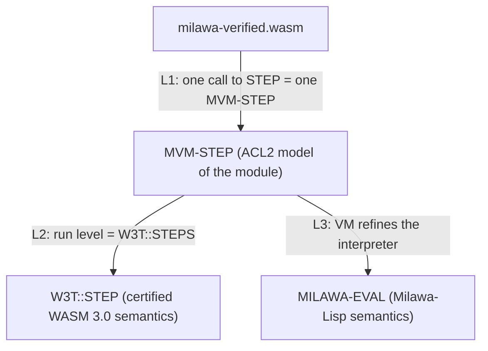

# milawa-verified-wasm — one page for reviewers

**Goal.** The sentence Milawa's `README` uses for Jitawa, with ACL2 for HOL4 and
WebAssembly for x86-64:

> if you run the simplified Milawa kernel on `milawa-verified.wasm` inside any
> conforming WebAssembly engine, it can only accept theorems of formulas that are
> semantically true.

**Shape.** Verify an *interpreter*, not a compiler.  `core.admit-defun` in
`milawa2.lsp` only records `(name formals body)` in a function table, so the
checker never calls a compiled definition; an interpreted function table
suffices, and the proof is O(size of the runtime) rather than O(size of the
kernel).  Three layers, each separately meaningful:



## What is proved (18 books, no `skip-proofs`, no `defaxiom`)

| Book | Content |
|---|---|
| `milawa-lisp/values.lisp` | value domain, 12 primitives, `2^30`-bounded arithmetic that aborts on overflow |
| `milawa-lisp/eval.lisp` | `MILAWA-STEP` (one step, total) and `MILAWA-RUN` (one tail-recursive fuel loop) |
| `milawa-lisp/programs.lisp` | kernel functions as data, in core syntax |
| `milawa-lisp/demo.lisp` | executable checks: rank, lookup, `ord<`, overflow, fuel exhaustion |
| `milawa-lisp/metatheory.lisp` | fuel monotonicity; abort/acceptance disjointness; zero fuel aborts |
| `milawa-lisp/reachability.lisp` | `MILAWA-RUNS`: exact step count, the two inference rules, positivity, shape, and that it agrees with `MILAWA-RUN` both ways |
| `machine/mvm.lisp` | `MVM-STEP`/`MVM-RUN`: the ACL2 model of the module, 32-bit words, status protocol.  A stopped machine is a fixed point; spending a budget in two instalments is spending it at once; **fuel monotonicity** — once it has stopped, a larger budget changes nothing |
| `machine/examples.lisp` | the example corpus: ten programs, each with the answer the artifact actually gives (recorded in `examples/*.mvm` from Node), proved about the model by evaluation — so the corpus is a test of the artifact and a proof about the model, kept separate on purpose |
| `machine/mvm-tests.lisp` | model vs module on a spread of programs — **tests, not proofs**, and labelled so |
| `wasm3/memory.lisp` | the L1 memory correspondence: an MVM state's image in the module's memory (32-bit little-endian words, stack below 4096, code above), with the round trip `bytes-to-word (word-to-bytes w) = w` for 32-bit words **and at region level — decoding a word list's image gives the word list back** — image lengths, and the disjointness invariant |
| `wasm3/abs.lisp` | the abstraction itself: `MVM` state → entry configuration of a call to the exported `STEP`, through the spec's own `$WITH_MEM`/`$WITH_GLOBAL`, and the inverse observations. **Sixteen theorems, one per path through the module** — every opcode, every abort, both frozen statuses — each giving the exact clock and the fact that what the semantics stopped on reads back as `MVM-STEP` |
| `wasm3/l1.lisp` | the certified semantics executes the artifact: entry configuration is a call to function 6 with no arguments, `STEP` applies and is single-valued, three steps apply, one step enters the frame |
| `wasm3/decode.lisp` | the artifact decodes completely and instantiates with no externs (scripted, since the decoder and the instantiator are `:program` mode); the module is pinned as a logic constant; its shape, export names, and the fact that `STEP` is function 6 are theorems |

## The example corpus

`examples/*.mvm` is the lower-level stand-in for a Milawa events file: ten programs
with the answer each must give.  Each file holds the program as MVM words and an
`expect:` line that is **recorded from the artifact**, never written by hand —
`harness/examples.py --record` runs `wasm/milawa-verified.wasm` in Node and writes
the line.  `machine/examples.lisp` (generated by `--gen-lisp`) then **proves** the
model gives the same answer, by evaluation.

| Example | Program | Answer |
|---|---|---|
| `if-lt-true` | `(if (< 1 2) 10 20)` | halted, 10, 6 steps |
| `if-lt-false` | `(if (< 2 1) 10 20)` | halted, 20, 6 steps |
| `arith` | `(+ 20 (- 3 1))` | halted, 22, 6 steps |
| `sum-1-to-5` | `(+ 1 (+ 2 (+ 3 (+ 4 5))))` | halted, 15, 10 steps |
| `sub-wraps` | `(- 0 1)` | halted, **4294967295**, 4 steps |
| `lt-signed` | `(< -1 0)` | halted, 1, 4 steps |
| `jmp` | JMP over a `CONST` | halted, 7, 3 steps |
| `unknown-opcode` | opcode 7 | aborted, 1 step, PC 1 |
| `const-truncated` | `CONST` with no immediate | aborted, 1 step, PC 1 |
| `halt-empty-stack` | `HALT` with an empty stack | aborted, 1 step, PC 1 |

So a passing corpus means *the artifact does X* (a test, in Node, through a host we
do not trust) **and** *the model does X* (a proof, by evaluation).  The sentence
that ties the two together — that they agree for all inputs — is L1, still open.
Keeping the two claims separate, and both checkable, is the point: when L1 lands,
these same ten files become its regression suite.

Two of them earn their place by disagreeing with the obvious guess: `sub-wraps`
because `(- 0 1)` is `#xFFFFFFFF` and the harness has to report it **unsigned**
(JS exports an `i32`, so it prints `-1` unless asked not to), and `lt-signed`
because `#xFFFFFFFF` is the largest unsigned word yet is *less than* zero under
`i32.lt_s`.

`wasm/milawa-verified.wat` is the module: hand-written, one exported `STEP` per
machine step — the granularity of `MILAWA-STEP` and `W3T::STEP`, so no layer has
to reason about a loop.  It runs in Node today (`node harness/run.js`).

## Trust inventory

| Trusted | Why |
|---|---|
| ACL2 and its host Lisp | already trusted by Milawa's stage-1 proof |
| SpecTec + the SpecTec→ACL2 translator | generated semantics; no theorem connects output to source |
| the WebAssembly engine | the role the CPU plays in Jitawa |
| the front end and the I/O shim | can only cause a rejection, never a false acceptance |
| **one execution of the certified binary decoder, and one of the instantiator**, to turn the `.wasm` into the module and store constants | `W3T::GRAM/BMODULE` and `W3T::$INSTANTIATE` are `:program` mode, so neither step can be a theorem; both are scripted and checked (`harness/gen_module.py --check`).  Everything after them — `$INVOKE`, `STEP`, `STEPS/%FUEL`, `MODULE-P` — is `:logic`, so L1 and L2 are statable |
| WABT (`wat2wasm`) | untrusted by construction: a buggy assembler can produce a module that fails the proof, never one that passes it |

Not trusted: the evaluator, the primitives, the heap, the compiled runtime, and —
once `kernel/` exists — the correspondence between the kernel program and
`logic.proofp`.

## Four findings worth passing on

1. **`definductive` gives an elimination principle you cannot afford.**  It admits
   the predicate over a proof object, so the generated scheme's step case is
   stated in terms of `-PROOF-KIND` and `-PROOF-STEP->C2`, not the rule premises;
   the only route back is the `ALT` rule, whose functional instantiation
   re-proves the source theorem by induction on that proof object.  Measured:
   >16 min, unfinished.  Stating the rules *as a function of the exact step count*
   gave the same theorems in **0.2 s** and the halt/step induction a refinement
   proof actually wants.
2. **A `mutual-recursion` clique gets no induction machine**, so an evaluator
   written as `eval`/`eval-args`/`eval-application` is a dead end for metatheory.
   The single tail-recursive loop is what makes the metatheory reachable.
3. **"Exactly N" ≠ "at most N".**  A relation defined from the fuelled loop says a
   halting machine runs in any larger count; a WASM `STEP` derivation gives an
   exact count, so the count must be spent.  And completeness must exclude fuel
   exhaustion, or the theorem is simply false (ACL2 found it).
4. **Keep the machine step symbolic.**  Expanding `MILAWA-STEP` (20 branches) or
   `MILAWA-CONF-STEP` in a symbolic proof turns one subgoal into ~150; every hard
   proof here depends on disabling it and matching the hypothesis instead.

## The abstraction, and the clock

`mvm-abs` turns an MVM state into the configuration the certified semantics runs:
the artifact's own store, with the stack image written below byte 4096 and the
code image above it, and five globals set — SP (byte offset), PC (byte address),
CODE-LEN, STATUS, RESULT.  Those five and the memory under SP are the module's
whole mutable state, so `milawa-observations` reads a stopped configuration back
as machine state.

With the abstraction fixed, the clock is a fact rather than a parameter.  One
machine step is **47 to 101 spec steps, and the count depends only on the
opcode**:

| Path | Spec steps |
|---|---|
| status already 0 or 2 (frozen) | 9 |
| PC off the end of the code | 26 |
| HALT with an empty stack (abort) | 47 |
| HALT, one or two values | 53 |
| CONST | 67 |
| CONST with the immediate off the end (abort) | 55 |
| ADD / SUB / LT | 96 / 101 / 101 |
| ADD with fewer than two values (abort) | 63 |
| IFZ taken / not taken | 99 / 95 |
| JMP | 78 |
| unknown opcode (abort) | 63 |

That the clock does not depend on the *values* is what makes the symbolic proof's
clock a small case split rather than a search, and it is why `abs.lisp` is the
template for L1 proper rather than a detour.  Two of the numbers are worth
reading twice: an unknown opcode is cheaper than a known one (63 < 96) because it
falls out of the dispatch chain straight into `$abort`, and a truncated `CONST`
is cheaper than a good one (55 < 67) because it aborts before pushing.

Two things about the spec's API that cost time and are now written down in the
book:

- `$WITH_MEM` and `$WITH_GLOBAL` take the store-**and-frame** pair `Z`, not a
  store: `($SOF Z)` is the store and `($FOF Z)` the frame, and the module's index
  vector — the thing mapping a module global to a store slot — lives in the
  *frame*.  A store alone cannot be updated.
- the frame `$INVOKE` builds does not answer `%GET-FIELD :MODULE`, so the
  observers read the store through the pinned frame.  That is sound and is what
  we want: the module is a constant of the artifact and only the store varies.

### What the symbolic version actually hits

Four measured attempts.  The negative results are the useful part: the obstacle
is not where the plan assumed, and one of them dissolved on measurement.

**(a) The whole 9-step frozen-status chain, no hints.**  It does not even start:
the goal comes back *unreduced*, with `STEPS/%FUEL`, `STEP` and `$INVOKE` still in
it.  ACL2 will not unfold a recursive definition on symbolic arguments unless
asked.  A hint problem, not a cost problem — so the earlier "900 s and no output"
run was not measuring the chain either.

**(b) The whole chain with `(enable w3t::step)`.**  Killed at 400 s.  (One step
*with* `step` enabled is the same 0.13 s and the same failure as (c), so enabling
it is not the lever either.)

**(c) One single step, no hints.**  The rewriter *does* expand `$INVOKE`,
`$WITH_GLOBAL`, `%GET-FIELD`/`%PUT-FIELD`, `EXPAND` and the module's own lookups,
so a configuration with concrete shape and symbolic leaves is tractable; it walks
down `STEP`'s rule chain and stops at `STEP/R-CTXT-INSTRS` — the rule that steps
*inside* an instruction sequence.  It fails in 0.13 s and 29k prover steps, cheap
enough to iterate on.

**(d) The context-rule guard, measured.**  I first read (c) as "the `%SIZE`
guard in the context rules needs context lemmas".  That was wrong, and the
measurement is in `wasm3/size.lisp`: the module's WASM code lives in the store's
`:CODE` field, which neither `$WITH_MEM` nor `$WITH_GLOBAL` touches, so **every
instruction list in a configuration is concrete**; only the memory bytes and the
five globals are symbolic.  And the split point the context rules search for is
decidable on a concrete instruction list:

```
(step/prefix7 '((:GLOBAL.GET 3) (:CONST (:I32) 1) ...))    = 0
(step/prefix7 '((:CONST (:I32) 7) (:RETURN)))              = 1
(step/prefix7 '((:CONST (:I32) 7) (:CONST (:I32) 9) ...))  = 2
```

So the `%SIZE` guard — which mentions only the instruction list — evaluates too,
and the strict size lemmas are **not** on the critical path.  They are in
`wasm3/size.lisp` anyway (with the bridge that `%SIZE` is `acl2-count` hidden
behind `mbe` and disabled), because they are cheap and true and would be what an
arbitrary-program statement needs.

So the remaining blocker for a symbolic step is (a)+(b): `STEP` is a chain of
`(let ((r (STEP/R-X c))) (if r r (next)))`, and on a symbolic configuration ACL2
cannot decide any `STEP/R-X`, so the proof splits on each in turn instead of
walking the chain.  The residual goal of the single step says so exactly:

```
Subgoal 2
(IMPLIES (W3T::STEP/R-CTXT-INSTRS <config>) ...)
```

The lever is therefore not to enable `STEP` (measured: no difference) but to
enable **one `STEP/R-X` at a time** and feed its recursive call from the previous
lemma.  Concretely, the recipe for one instruction is:

1. state the successor as an explicit term, so nothing is invented at proof time;
2. `:in-theory (e/d (step/r-<that-rule>) (w3t::step))` — unfold only the rule, so
   the inner `STEP` stays symbolic and becomes the *hypothesis* rather than a thing
   to evaluate;
3. discharge that inner `STEP` with the lemma proved at the previous instruction,
   by `:use`, i.e. compose the chain by hand instead of asking ACL2 to run it.

That is an instruction-lemma library with the recursion factored out, and it is
the same object the engine's E4 builds — arrived at from the other direction.

The order of work that follows:

1. **An instruction-lemma library**: one lemma per (instruction, context) pair,
   with a concrete instruction list, the store's code concrete, and the values
   symbolic; each proved with only the one rule it needs enabled, then composed.
   Upstream measures ~10k prover steps for the first such lemma.
2. **C2 per opcode** as a chain of those lemmas — ~50 to 100 links, exactly the
   clock in the table above, writable because the clock does not depend on the
   values.
3. **An abstract memory** in the abstraction rather than the materialised page, so
   that the `take`/`append`/`nthcdr` of `$WITH_MEM` on a 65536-element list stops
   appearing in every term.

## Where L1 stands

The certified WASM 3.0 semantics **executes the artifact**, and that is proved, not
tested: `wasm3/l1.lisp` pins the instantiated store and frame as logic constants
and proves, by evaluation on them, that the entry configuration exists, that it is
a call to function 6 with no arguments, that `STEP` applies and is single-valued,
that three steps still apply, and that one step enters the frame pushed for our
function's locals.  Those are the first facts here stated about the certified
semantics running our module rather than about our model of it.

Getting there needed the API written down: `$INSTANTIATE` returns a
*configuration*, not a store (ours is already final, since the module has no
imports, data or start function); the store and frame are `(CADR (CADR C))` and
`(CADDR (CADR C))`; `$INVOKE` builds the entry configuration; `STEP` returns the
*list* of successors.

Two steps remain outside the logic: decode and instantiate are both `:program`
mode, so they are scripted and drift-checked (`harness/gen_module.py --check`)
rather than proved.  Everything after them is statable.

With `abs.lisp` the *statement* of L1 is fixed and checked on every path the
module has: sixteen ground theorems, each giving the exact clock, each showing
one more step is not available, and each showing that the configuration the
semantics stopped on reads back as `MVM-STEP`.  What remains is the same theorem
with the state symbolic — a symbolic execution of the module's twelve function
bodies.  That is the piece the `wasm-acl2` engine goes after as E11, and it is
unfinished there too (its C2 is proved for clock-0 steps only), so this is the
project's hardest open problem, not a formality.

Underneath L1 proper sits the memory correspondence, and the hardest piece of it
is now proved: **decoding the image of a word list gives the word list back**
(`mvm-image-words-of-mvm-word-list-to-bytes`), and the stack case follows
(`mvm-image-of-stack`).  The route there is worth recording, because the obvious
statements do not work:

- the indexed form `(nthcdr (* 4 i) bytes)` is the natural thing to write and is
  unusable — `(* 4 i)` blocks every append lemma, and rewriting it to
  `(+ 4 (* 4 (i-1)))` makes ACL2's `fold-consts-in-+` fold it straight back, to a
  HARD ERROR [Call depth] 1000;
- letting the recogniser `mvm-word-list-p` unfold splits each induction step on
  `(integerp (car ws))`, `(<= 0 ...)` and `(< ... 2^32)`: 259, then 4963 subgoals,
  387 s and 56 GB before giving up;
- letting `mvm-word-to-bytes` unfold brings `loghead`/`logtail` in, and ACL2 then
  splits on the arithmetic: 9.5M prover steps, still open.

What closes it is all three together: a decoder that consumes four bytes a step
(`car`/`cadr`/`caddr`/`cadddr` instead of an index), a **step rule** about the
append form, and the recogniser plus the byte-level definitions **disabled** so
that forward-chaining supplies the recogniser's facts without ever unfolding it.
The induction then finishes in 0.48 s.

## What is next, in order

1. **L1, symbolic**: the sixteen paths of `abs.lisp` generalised to symbolic
   state.  The clock is already known per opcode, so the shape is seven
   independent lemmas plus the frozen-status and off-the-end cases.
2. **L2**: the run level.  Each machine step is a fresh `$INVOKE`, so the run
   theorem is a "re-entry" composition rather than one long `STEPS/%FUEL`; the
   engine's `ENGINE-RESULT-IS-SPEC-RESULT` packaging (`wasm-acl2` `engine/`) is
   the reference, not a drop-in.
3. **L3**: `MVM` running compiled code refines `MILAWA-EVAL`, with the compiler
   untrusted — L3 is what makes that acceptable.
4. Conses, symbols, environments and the heap in the module and the model; then
   the whole `milawa-init` kernel, and one lemma per `defun` against
   `ACL2/logic/`.

## Reproducing

```sh
make -C books/projects/milawa-verified-wasm/milawa-lisp ACL2=$ACL2   # 7 books, seconds
make -C books/projects/milawa-verified-wasm/machine     ACL2=$ACL2   # 3 books, seconds
make -C books/projects/milawa-verified-wasm/wasm3       ACL2=$ACL2   # 7 books, needs the pin
```

The `wasm3/` books depend on `wasm-acl2`, pinned at `7f96c89` and cloned (not
vendored) as `/workspaces/acl2/.wasm-acl2`; they are listed in `cert_pl_exclude`
so a community certification run never has to find it.  The 26 books of the WASM
3.0 semantics are generated from the checked-in IL (`make gen SPEC=3.0`, ~2 min)
and certified (~5 min); `make -C translate check-il SPEC=3.0` re-derives that IL
from the spec sources through Nix and reports it reproducible.

Design and plan: [`../milawa/VERIFIED-WASM-LISP.md`](../milawa/VERIFIED-WASM-LISP.md).
