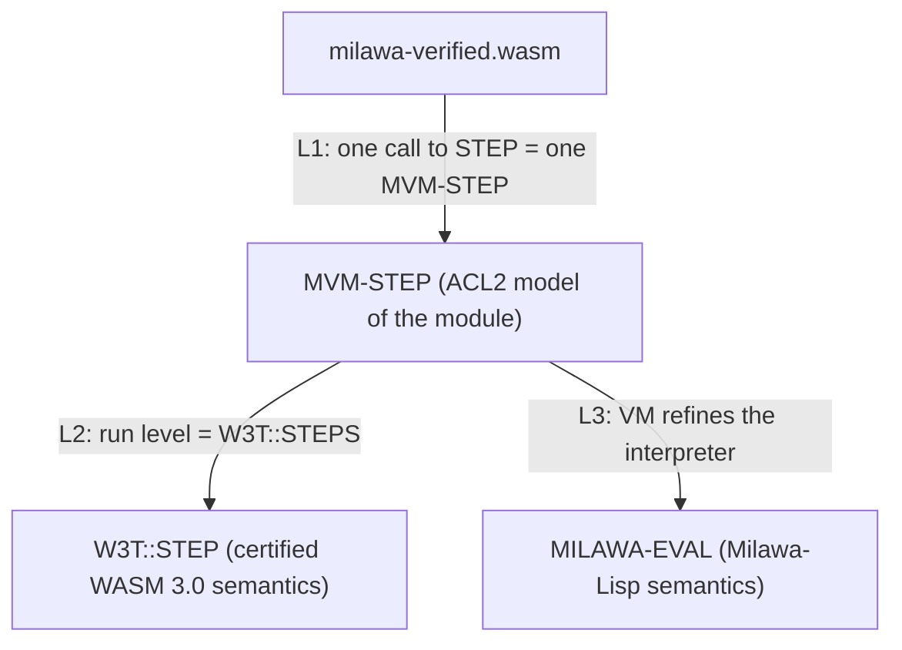

# milawa-verified-wasm — one page for reviewers

**Goal.** The sentence Milawa's `README` uses for Jitawa, with ACL2 for HOL4 and
WebAssembly for x86-64:

> if you run the simplified Milawa kernel on `milawa-verified.wasm` inside any
> conforming WebAssembly engine, it can only accept theorems of formulas that are
> semantically true.

**Shape.** Verify an *interpreter*, not a compiler.  `core.admit-defun` in
`milawa2.lsp` only records `(name formals body)` in a function table, so the
checker never calls a compiled definition; an interpreted function table
suffices, and the proof is O(size of the runtime) rather than O(size of the
kernel).  Three layers, each separately meaningful:



## What is proved (thirteen books, no `skip-proofs`, no `defaxiom`)

| Book | Content |
|---|---|
| `milawa-lisp/values.lisp` | value domain, 12 primitives, `2^30`-bounded arithmetic that aborts on overflow |
| `milawa-lisp/eval.lisp` | `MILAWA-STEP` (one step, total) and `MILAWA-RUN` (one tail-recursive fuel loop) |
| `milawa-lisp/programs.lisp` | kernel functions as data, in core syntax |
| `milawa-lisp/demo.lisp` | executable checks: rank, lookup, `ord<`, overflow, fuel exhaustion |
| `milawa-lisp/metatheory.lisp` | fuel monotonicity; abort/acceptance disjointness; zero fuel aborts |
| `milawa-lisp/reachability.lisp` | `MILAWA-RUNS`: exact step count, the two inference rules, positivity, shape, and that it agrees with `MILAWA-RUN` both ways |
| `machine/mvm.lisp` | `MVM-STEP`/`MVM-RUN`: the ACL2 model of the module, 32-bit words, status protocol.  A stopped machine is a fixed point; spending a budget in two instalments is spending it at once; **fuel monotonicity** — once it has stopped, a larger budget changes nothing |
| `machine/mvm-tests.lisp` | model vs module on a spread of programs — **tests, not proofs**, and labelled so |
| `wasm3/memory.lisp` | the L1 memory correspondence: an MVM state's image in the module's memory (32-bit little-endian words, stack below 4096, code above), with the round trip `bytes-to-word (word-to-bytes w) = w` for 32-bit words, image lengths, and the disjointness invariant |
| `wasm3/l1.lisp` | the certified semantics executes the artifact: entry configuration is a call to function 6 with no arguments, `STEP` applies and is single-valued, three steps apply, one step enters the frame |
| `wasm3/decode.lisp` | the artifact decodes completely and instantiates with no externs (scripted, since the decoder and the instantiator are `:program` mode); the module is pinned as a logic constant; its shape, export names, and the fact that `STEP` is function 6 are theorems |

`wasm/milawa-verified.wat` is the module: hand-written, one exported `STEP` per
machine step — the granularity of `MILAWA-STEP` and `W3T::STEP`, so no layer has
to reason about a loop.  It runs in Node today (`node harness/run.js`).

## Trust inventory

| Trusted | Why |
|---|---|
| ACL2 and its host Lisp | already trusted by Milawa's stage-1 proof |
| SpecTec + the SpecTec→ACL2 translator | generated semantics; no theorem connects output to source |
| the WebAssembly engine | the role the CPU plays in Jitawa |
| the front end and the I/O shim | can only cause a rejection, never a false acceptance |
| **one execution of the certified binary decoder, and one of the instantiator**, to turn the `.wasm` into the module and store constants | `W3T::GRAM/BMODULE` and `W3T::$INSTANTIATE` are `:program` mode, so neither step can be a theorem; both are scripted and checked (`harness/gen_module.py --check`).  Everything after them — `$INVOKE`, `STEP`, `STEPS/%FUEL`, `MODULE-P` — is `:logic`, so L1 and L2 are statable |
| WABT (`wat2wasm`) | untrusted by construction: a buggy assembler can produce a module that fails the proof, never one that passes it |

Not trusted: the evaluator, the primitives, the heap, the compiled runtime, and —
once `kernel/` exists — the correspondence between the kernel program and
`logic.proofp`.

## Four findings worth passing on

1. **`definductive` gives an elimination principle you cannot afford.**  It admits
   the predicate over a proof object, so the generated scheme's step case is
   stated in terms of `-PROOF-KIND` and `-PROOF-STEP->C2`, not the rule premises;
   the only route back is the `ALT` rule, whose functional instantiation
   re-proves the source theorem by induction on that proof object.  Measured:
   >16 min, unfinished.  Stating the rules *as a function of the exact step count*
   gave the same theorems in **0.2 s** and the halt/step induction a refinement
   proof actually wants.
2. **A `mutual-recursion` clique gets no induction machine**, so an evaluator
   written as `eval`/`eval-args`/`eval-application` is a dead end for metatheory.
   The single tail-recursive loop is what makes the metatheory reachable.
3. **"Exactly N" ≠ "at most N".**  A relation defined from the fuelled loop says a
   halting machine runs in any larger count; a WASM `STEP` derivation gives an
   exact count, so the count must be spent.  And completeness must exclude fuel
   exhaustion, or the theorem is simply false (ACL2 found it).
4. **Keep the machine step symbolic.**  Expanding `MILAWA-STEP` (20 branches) or
   `MILAWA-CONF-STEP` in a symbolic proof turns one subgoal into ~150; every hard
   proof here depends on disabling it and matching the hypothesis instead.

## Where L1 stands

The certified WASM 3.0 semantics **executes the artifact**, and that is proved, not
tested: `wasm3/l1.lisp` pins the instantiated store and frame as logic constants
and proves, by evaluation on them, that the entry configuration exists, that it is
a call to function 6 with no arguments, that `STEP` applies and is single-valued,
that three steps still apply, and that one step enters the frame pushed for our
function's locals.  Those are the first facts here stated about the certified
semantics running our module rather than about our model of it.

Getting there needed the API written down: `$INSTANTIATE` returns a
*configuration*, not a store (ours is already final, since the module has no
imports, data or start function); the store and frame are `(CADR (CADR C))` and
`(CADDR (CADR C))`; `$INVOKE` builds the entry configuration; `STEP` returns the
*list* of successors.

Two steps remain outside the logic: decode and instantiate are both `:program`
mode, so they are scripted and drift-checked (`harness/gen_module.py --check`)
rather than proved.  Everything after them is statable.

## What is next, in order

1. Pin the instantiated store as a logic constant (instantiation is `:program`
   mode too), which completes the configuration L1 and L2 are stated about.
2. **L1**: one call to the exported `STEP` equals `MVM-STEP`, for a well-formed
   state.  `MILAWA-VERIFIED-STEP-IS-FUNCTION-6` says which body to reason about.
3. **L2**: instantiate `ENGINE-RESULT-IS-SPEC-RESULT` from `wasm-acl2`'s
   `engine/`, discharging its four constraints for `MVM`.  Its C2 (clock-1 steps)
   is an open proof upstream; we may have to finish it or carry a
   stated-and-tested hypothesis.
4. **L3**: `MVM` running compiled code refines `MILAWA-EVAL`, with the compiler
   untrusted — L3 is what makes that acceptable.
5. Conses, symbols, environments and the heap in the module and the model; then
   the whole `milawa-init` kernel, and one lemma per `defun` against
   `ACL2/logic/`.

## Reproducing

```sh
make -C books/projects/milawa-verified-wasm/milawa-lisp ACL2=$ACL2   # 7 books, seconds
make -C books/projects/milawa-verified-wasm/machine     ACL2=$ACL2   # 3 books, seconds
make -C books/projects/milawa-verified-wasm/wasm3       ACL2=$ACL2   # 3 books, needs the pin
```

The `wasm3/` books depend on `wasm-acl2`, pinned at `7f96c89` and cloned (not
vendored) as `/workspaces/acl2/.wasm-acl2`; they are listed in `cert_pl_exclude`
so a community certification run never has to find it.  The 26 books of the WASM
3.0 semantics are generated from the checked-in IL (`make gen SPEC=3.0`, ~2 min)
and certified (~5 min); `make -C translate check-il SPEC=3.0` re-derives that IL
from the spec sources through Nix and reports it reproducible.

Design and plan: [`../milawa/VERIFIED-WASM-LISP.md`](../milawa/VERIFIED-WASM-LISP.md).
