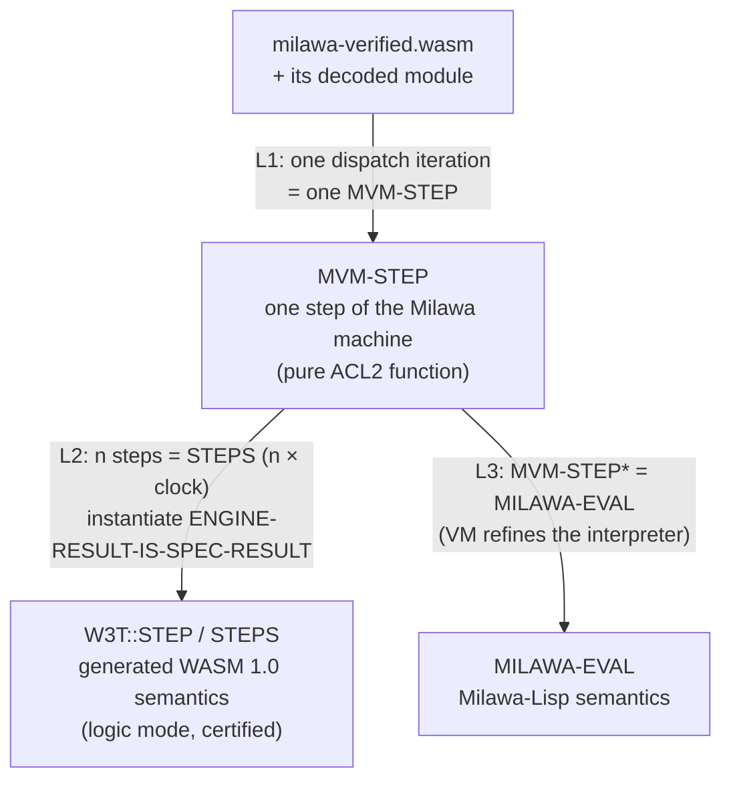

# A verified Lisp runtime for Milawa, verified in ACL2, targeting WebAssembly

Design and plan.  Companion to `MILAWA-WASM.md`, which covers the *unverified*
WebAssembly checker we have today.

---

## 0. Summary

Milawa's claim is a chain.  `README` puts it best:

> Magnus Myreen has used the HOL4 system to prove ... if you run the simplified
> Milawa kernel on the Jitawa runtime on a 64-bit X86 system, it can only accept
> theorems of formulas that are semantically true.  This theorem connects the
> logical semantics, down through the kernel's source code, through the Jitawa
> Lisp implementation, down to a formal HOL model of the x86 machine code.

We want the same sentence with *ACL2* in place of HOL4 and *WebAssembly* in
place of x86-64:

> **If you run the simplified Milawa kernel on `milawa-verified.wasm` inside any
> conforming WebAssembly engine, it can only accept theorems of formulas that
> are semantically true.**

The things that make this tractable now, and did not exist in 2012:

1. **A WASM semantics in ACL2 exists.**  `wasm-acl2` (Ray Myers) has a complete
   WASM 1.0 formalisation, spec-generated WASM 3.0 including the *binary
   decoder* and validator, and a fast engine with a reusable run-level
   simulation theorem.  Everything is certified.  We do not have to write a
   machine model.
2. **Milawa already wrote the runtime's target for us.**  `milawa2.lsp` is a
   *simplified* kernel written for exactly this purpose: 12 primitives,
   fixnum-only arithmetic that **aborts on overflow** instead of using bignums,
   the whole program expressed as data (`(name formals body)` triples), and an
   input format with `#n=` / `#n#` structural sharing.  It is the Jitawa target,
   and it is a far better target than `milawa.lsp`.
3. **The kernel never calls a function defined by an event.**  See §3.1.  So the
   runtime does not need a JIT, and does not need a verified compiler either —
   an interpreted function table suffices.  This is the single largest
   simplification available over Jitawa.
4. **The W3T semantics has a *relational*, logic-mode step** we can state
   theorems about, rather than a program-mode interpreter.

Recommended shape: **verify an interpreter, not a compiler.**  The proof work is
then O(size of the runtime), not O(size of the Milawa kernel), and the kernel can
grow without redoing proofs.

Recommended location: **this document stays in `books/projects/milawa/`; the
proof tree goes in a new sibling project directory, not inside Milawa's own
book tree.**  Rationale in §6.

### 0.1 Progress (2026-11-18)

The work has started at `books/projects/milawa-verified-wasm/`; see its `README`
for the authoritative status, and its "What we learned" section for the ACL2 and
`definductive` findings.  In terms of the phases below:

- **Phase 1 (the spec) is largely done.**  `MILAWA-EVAL` exists as a total,
  fuelled machine (`MILAWA-STEP` plus the one-tail-call loop `MILAWA-RUN`) in
  core syntax, with the twelve primitives, the `2^30` abort discipline, a
  differential-style check book, fuel monotonicity, and the abort/acceptance
  facts.  It is a *single* recursive function rather than the mutual recursion
  suggested by the shape of an evaluator, because a `mutual-recursion` clique
  gets no induction machine in ACL2 and the metatheory becomes unreachable.
- **A relational presentation exists and is usable** (`MILAWA-RUNS`, via
  `std/util/definductive`), which is the shape `W3T::STEP` has and therefore
  what L1 will compare a WASM module against.  Its elimination principle is
  proved but currently too expensive to keep in the default build; the recipe
  and the reason are recorded at the end of `reachability.lisp`.
- **Phases 2-6 are untouched.**  Nothing has been built against a WASM
  semantics yet, so the L1/L2 risk analysis in §8 is unchanged.

One correction to the plan as written: §3.1 treats "the kernel never calls a
function installed by an event" as something to confirm by instrumentation
(experiment E2).  It is still unconfirmed; the design does not depend on it
soundly — if it is false, user definitions are interpreted rather than compiled,
which costs performance but no proof.

---

## 1. What the current WASM build trusts

`wasm/` compiles ECL (a full Common Lisp, ~100k lines of C and Lisp) with
emscripten (a clang/SIMD/JS toolchain) and runs `milawa.lsp`, the full kernel.

Trusted today: ACL2 + the stage-1 proof, ECL, emscripten's wasm backend,
Binaryen, V8/Node, and the C/JS shim.

The whole point of a verified runtime is to delete the middle of that list.  The
end state should be:

| Trusted | Why it is acceptable | Jitawa analogue |
|---|---|---|
| ACL2 and its host Lisp | already trusted by Milawa stage 1; shared cost | HOL4 |
| SpecTec + the SpecTec→ACL2 translator (`wasm-acl2`) | generated semantics, tested against the official suite; *no theorem connects output to source*, per its README | the x86 ISA model |
| A conforming WASM engine (V8 / wasmtime) | same role the CPU plays in Jitawa | the CPU |
| I/O shim + event converter | can only cause *rejection*, never false acceptance (§3.5) | `wrapper.c`, `jit_exec.s` |

Everything else — the interpreter, the allocator, the reader, the compiled
runtime, and the correspondence between the kernel program and `logic.proofp` —
is proved.

**Non-goal for v1:** proving the WASM engine.  Verifying V8 is a different
project; the honest statement is "for any engine that implements the W3T
semantics", which is exactly how Jitawa treats the ISA model.

---

## 2. Assets already in this tree, and their state

| Asset | What it gives us | State |
|---|---|---|
| `ACL2/logic/`, `ACL2/bootstrap/logic/` | `logic.proofp` and its soundness theory — the *specification* the runtime must meet | certified, current |
| `ACL2/bootstrap/jitawa/export.lisp` | `convert-events`: `Proofs/*.events` → `full.events` in DAG notation.  The untrusted converter, already written | runs under ACL2(h) with huge memory; `100.events` is a prefix |
| `milawa2.lsp` | the simplified kernel: 2001 lines, 12 primitives, fixnum+abort, program-as-data, `#n=` reader | **stale** — reads `ACL2/bootstrap/verified-lisp/full.events`, a directory that no longer exists |
| `milawa.lsp` + `wasm/` | the current unverified WASM checker | working |
| `books/kestrel/wasm/` | Kestrel's WASM package, `defaggregate` types, binary parser | in-tree skeleton: only `local.get`/`i32.add` |
| `wasm-acl2` (external) | WASM 1.0 complete (170/170), WASM 3.0 generated incl. decode/validate/instantiate, verified-ish engine | MIT; not in community books; pin a commit |

`milawa2.lsp`'s shape is the crux of the design, so it is worth restating what
it actually contains:

- **Value domain.**  Symbols, conses, `t`/`nil`, and integers in `[0, 2^30)`.
  `+` checks `< 1073741824` and calls `(error "Overflow in +.")` otherwise.
  There is no bignum arithmetic anywhere in the target.  `natp` is `integerp`
  (`milawa2.lsp:78`), and `symbol-<` is `string<` on `symbol-name`
  (`milawa2.lsp:81`), so only symbol *names* matter.
- **Language.**  `if`, `equal`, `consp`, `cons`, `car`, `cdr`, `symbolp`,
  `symbol-<`, `natp`, `<`, `+`, `-`, plus `let`, `let*`, `cond`, `and`, `or`,
  `not`, `list`, `lambda` (all macro-expandable) and function calls
  (`milawa2.lsp:61-104`).
- **The kernel is a list.**  `milawa-init` is `'(define-safe-list '((f (x) body)
  ...))`.  The program is data, checked into a function table by
  `define-safe`, which rejects any redefinition of a kernel function.
- **Input.**  `full.events` in `#n=` / `#n#` notation, read by
  `milawa-sharp-equal-reader` into a hash table of shared substructure.

---

## 3. Design

### 3.1 Decision: interpret the kernel program; do not compile it

Jitawa is a *JIT* because Myreen compiled each Lisp form to machine code.
`milawa2.lsp` also compiles: `MILAWA::define` is

```lisp
(eval `(compile (defun ,name ,formals (declare (ignorable ,@formals)) ,body)))
```

But look at who consumes the result.  In `core.admit-defun`
(`milawa2.lsp:1746`), `define-safe` is called and its value — the new function
table — is stored in the checker state.  Nothing in `core.check-proof`,
`core.check-proof-list`, or any `logic.translate` call ever *calls* the function
that was just defined.  Definitions enter the object logic as **axioms**
(`logic.pequal (logic.function name formals) body`), and the checker reasons
about them symbolically.  The `compile` exists so that the host Lisp has a
callable function, which only matters for exploration at the REPL.

So split the kernel's `define` in two:

- `define-kernel-fn` — the fixed set from `milawa-init` (`rank`, `ord<`, `ordp`,
  `logic.translate`, `core.check-proof`, ...).  Known at build time; part of the
  runtime image.
- `install-user-def` — a pure function-table update, no code generation.

**Proof obligation (P4 below):** the checker never calls a function installed by
`install-user-def`.  This is a concrete, checkable invariant on `ftbl`: a
"kernel-only" predicate on the function symbols reachable from the checker's
code, preserved by every state transition.  If it is false, we fall back to
interpreting user definitions, which is slower but needs no new proof; a JIT
would only ever be a performance option, never a soundness requirement.

This is worth verifying early with an experiment (§8, E2) because the whole
architecture rests on it.

### 3.2 The source language: Milawa-Lisp

Define, in ACL2, a total semantics for the language of `milawa2.lsp`:

```
MILAWA-EVAL : program × fn × values × fuel → result
result      ::= (:ok value) | (:abort reason)
```

Three properties matter:

1. **`(:abort ...)` is never acceptance.**  This is how the semantics absorbs
   every place where Common Lisp would signal, quit, or overflow.  `+` beyond
   `2^30` is an abort; a reader error is an abort; heap exhaustion is an abort.
   Because aborts are a distinguished constructor, the top-level theorem can
   say: the kernel answers `accept`, `reject`, or `abort`, and `accept` implies
   `logic.proofp`.  Partiality never has to be modelled — the ACL2 function is
   total and returns the sum.
2. **Bounded integers are part of the spec, not an implementation detail.**
   The correspondence to `logic.proofp` must be stated for `[0,2^30)`; outside
   it we get an abort.  (Whether the real proof corpus stays under `2^30` is a
   measurable question — `rank` is the obvious risk.  If it does not, v2 needs
   a verified bignum layer, which is a separate project.)
3. **The program is a value.**  No `eval` at run time, no macro expansion at run
   time: `let`, `cond`, `and`, `or` are expanded once, by the *untrusted*
   surface syntax, into the core (`if`/`lambda`/`quote`/calls).  The verified
   semantics sees only the core.

The semantics uses an explicit environment (alist or index-addressed frame) and
an explicit stack, so that no CL implementation detail (value stack size,
binding stack, `apply` trampoline) leaks into the spec.

### 3.3 The runtime: an explicit-stack machine

```
MVM state ::= (pc, frames, value-stack, heap, ftbl, status)
MVM-STEP  : state → state
```

- **Frames on the heap.**  Recursion must not consume the WASM value stack,
  because that stack is host-sized and not visible to the semantics
  (`MILAWA-WASM.md` already has to buy 1 GB of it).  Push continuations onto a
  heap-allocated stack instead.  This also removes the need for WASM tail calls,
  which keeps the instruction subset small.
- **Heap = a bump allocator over linear memory.**  v1 has **no GC**.  Two
  sound options, in increasing power:
  - *abort on exhaustion* — trivially sound, and adequate to get an artifact
    working;
  - *arena reset at event boundaries* — sound if the invariant "between events,
    the only live values are the checker state and the current event's input"
    is proved.  That invariant is very natural here, because each event's proof
    data is dead after it is accepted or rejected.
  A full copying GC is explicitly out of scope for v1.
- **`ftbl`** is an array of `(name, arity, formals, body)`; calls are by index.
- **Arithmetic** is `i32` with the kernel's own overflow guard, so that the
  machine and `MILAWA-EVAL` fail at exactly the same point.
- **Symbols** are heap objects with a name; `symbol-<` compares names, matching
  `milawa2.lsp`.  A lemma relates `kernel-symbol-<` to `logic.symbol-<` on
  admissible Milawa symbols (single package, so package names compare equal and
  the comparison collapses to `string<` on names) — same shape as Jitawa's
  obligations about `symbol-<`.

### 3.4 The WASM side

**Which semantics: WASM 3.0.**  Depend on `wasm-acl2` `main`, pinned.  Target
the generated WASM 3.0 semantics (`translate/gen/wasm-3.0`, `W3T::STEP`),
because:

- it is the most complete and current artifact: syntax, validation, numerics,
  execution and the binary format are all translated, and the generated step is
  in logic mode; 64,005 of 64,018 spec-test-3 commands pass;
- the binary decoder is *inside* the formal model, so the shipped `.wasm` file
  can itself be the subject of the theorem rather than a reconstruction of it;
- `main` also carries the faster `engine/` (list machine and stobj machine, with
  `FAST-STEP-REFINES` per rule) plus `ENGINE-RESULT-IS-SPEC-RESULT`, which is
  the theorem L2 instantiates.

The instruction subset we *emit* stays small regardless: the integer core,
memory ops, structured control flow, and calls — no floats, no SIMD, no
reference types, no GC, no exceptions, no tail calls.  Restricting what we emit
is how L1 stays tractable; it does not restrict what the semantics can describe.

Two consequences worth stating: the 3.0 soundness judgements (`7.*`) and the
text format (`6.*`) are deferred, so type safety is not available for free and
non-trapping must be proved for our module; and `wasm-acl2` is not in the
community books, so the dependency is pinned and either vendored or excluded
from the community scan, never assumed.

**Instruction subset actually emitted.**  `i32.const`, `i32` arithmetic and
comparisons, `local.get/set/tee`, `global.get/set`, `i32.load/store` (8/16/32),
`memory.size`, `memory.grow`, `block`/`loop`/`if`/`else`/`br`/`br_if`/`br_table`/
`return`/`call`/`drop`/`select`/`nop`.  No floats, no SIMD, no refs, no tail
calls.  The smaller the subset, the smaller the per-step proof and the faster
symbolic execution.

**Proof layering.**  Three layers, each independently meaningful, mirroring the
structure `wasm-acl2`'s engine already uses:



- **L1 (per-step refinement).**  For a well-formed `MVM` state, one iteration of
  the module's dispatch loop equals `MVM-STEP`.  Straight-line reasoning over
  ~40 instructions, plus the frame/heap invariant.  This is where the trust in
  the *hand-written module* is discharged.  Our own module is ~1-2k lines of
  WAT, so this is finite, mechanical work.
- **L2 (run level).**  Do not prove this from scratch: `wasm-acl2`'s
  `engine/theorem/simulation.lisp` has `ENGINE-RESULT-IS-SPEC-RESULT`, stated for
  *any* machine given four constraints (invariant preserved by a step, a step is
  `clock` spec steps, a result is terminal, a stopped machine has a result).
  Discharge C1, C3, C4 for `MVM` and instantiate.  **Known caveat:** C2 for
  clock-1 steps is the open proof in `wasm-acl2` (their "E11"), so we may have to
  finish that, or prove our own instance for the integer core, or carry a
  stated-and-tested hypothesis.  Budget for this; it is the largest dependency
  risk in the plan.
- **L3 (VM refines the interpreter).**  `run(MVM, compile(p), args) =
  MILAWA-EVAL(p, f, args)`.  Standard machine-refinement induction over the
  frame stack.  This is the proof that makes the artifact a *Lisp* rather than a
  one-off program.

The compiler from core Milawa-Lisp to MVM *bytecode* is untrusted, and stays
untrusted.  L3 is what makes that acceptable.

### 3.5 Input, output, and why the shim cannot cause false acceptance

The verified core takes a **parsed value**: a list of events with shared
substructure, exactly what `milawa-sharp-equal-reader` produces.  It does not
take bytes.

- The bytes → value step (the `#n=` reader) is in the shim, like Jitawa's C
  wrapper.  The theorem is stated about the value; a faithful reading is an
  assumption, and an unfaithful one can only produce a *different* value, which
  the checker then judges on its own merits.
- **The soundness statement we care about is monotone in the input.**  We prove
  `MILAWA-EVAL(kernel, E) = accept ⟹ logic.proofp(...)` for all `E`, not just
  well-formed or honestly-produced `E`.  Then a buggy converter cannot create a
  false theorem: at worst it turns a valid development into a rejected one.
  This is the same posture Jitawa takes, and it is why the converter
  (`ACL2/bootstrap/jitawa/export.lisp`) can stay unverified despite being the
  component that reads 500M conses.
- If we want the reader inside the boundary later, it is a small addition: the
  `#n=`/`#n#` reader is a few dozen lines and does not need `eval`.  It is a
  good "phase 5.5" stretch goal, not a v1 requirement.
- Output (`accept`/`reject`, and printing) is a shim.

Note: structural sharing means the input is a DAG, not a tree.  That is fine —
`equal` is structural — but the counter the machine keeps (`rank`) and the
arena's sharing behaviour must both be modelled as "same value", not "same
address".  Say so explicitly in the invariants.

---

## 4. Alternatives considered

| Option | Verdict |
|---|---|
| Verify the ECL + emscripten chain | Hopeless: the trust base is the whole CL implementation. |
| Translate-validate the ECL-compiled `milawa.o` against an ACL2 spec | Fallback only.  ECL's output uses closures, bignums, a GC, and boxed paths; the target program is large and adversarial to symbolic execution. |
| Prove an ACL2-subset → WASM *compiler* correct | Attractive endgame (gives "for all programs" closure and speed) but a much larger proof, and unnecessary while the kernel program is fixed at build time.  Revisit in phase 6. |
| Do it in CakeML / HOL4 | Correct tool for Jitawa, wrong repo and wrong ask. |
| Use `books/projects/x86isa` as the machine | Mature, but the ask is WASM. |
| Use `kestrel/jvm` as the machine | Viable and well-tooled; WASM chosen over it. |
| Verify `milawa.lsp` (the full kernel) | No.  `milawa2.lsp` exists precisely to be a small target; the full kernel adds hash tables, `eval`, and reader macros. |

---

## 5. Phases

Each phase ends with a concrete artifact and an acceptance test.  Phase 0 and 1
are cheap and de-risk everything after them.

### Phase 0 — Groundwork and decisions (1-2 weeks)

- Resurrect the `milawa2.lsp` path: regenerate `full.events` from
  `Proofs/*.events` with `ACL2/bootstrap/jitawa/export.lisp`, and replay it under
  CCL.  Confirm the simplified kernel's verdicts match `milawa.lsp`'s on
  `Proofs/utilities.events`.
- **E2, decisive experiment.**  Instrument `ftbl` so that a call to a symbol
  installed by `install-user-def` is logged.  Run the utilities level.
  Expected: zero such calls.  If not, note which functions and adjust §3.1.
- **E3.**  Instrument `+` to record the maximum value reached during a level.
  Confirms whether `2^30` is safe, and how much headroom there is.
- Pin `wasm-acl2`; record the exact books and the commit.  (Decided: WASM 3.0,
  `main`, per §3.4.)
  Read `plan/wasm-engine/evidence.md` and record which of C1-C4 are covered.
- Write the theorem statement (§7) into a book as an `encapsulate`/`defstub`
  skeleton so it can be reviewed before it is proved.

**Exit:** `full.events` replays; E2/E3 answered; theorem statement in the tree.

### Phase 1 — The spec: `MILAWA-EVAL` (3-4 weeks)

- Books under `milawa-lisp/`: values, core syntax, environments, frames,
  `MILAWA-EVAL` with fuel, `:ok`/`:abort`.
- A differential harness: run `milawa-init` under both CCL and `MILAWA-EVAL` on
  every event of `100.events` and compare.  (This is testing, not proof, and it
  is what makes the later proof statements believable.)
- Prove the small metatheory: determinism, fuel monotonicity, the abort
  discipline, and the `symbol-<` bridge to `logic.symbol-<`.

**Exit:** `MILAWA-EVAL` reproduces CCL's verdicts on `100.events` and the
metatheory certifies.

### Phase 2 — First end-to-end verified artifact (6-10 weeks)

Deliberately toy, deliberately complete: a WASM module implementing
`if/equal/consp/cons/car/cdr/quote` plus fixnum `+ - < natp symbolp`, calls, and
the explicit frame stack — enough to run a 20-line Lisp program.

- L1 for that module (per-step refinement, certified).
- L2 for that module (instantiate the simulation theorem; if C2 is still open in
  `wasm-acl2`, prove the integer-core instance here).
- L3 for the core subset.

**Exit:** a certified `wasm-run(module, p, args) = MILAWA-EVAL(p, f, args)`, and
the module actually executes in Node and in a browser.  This is the Jitawa
equivalent of "verified code runs a Lisp program".  After this, everything else
is scale.

### Phase 3 — The real runtime (2-3 months)

- Symbols with names, the `ftbl`, arena heap with abort-on-exhaustion, the
  `#n=`-annotated event format, the checker program from `milawa2.lsp`'s
  `milawa-init`.
- Extend L1/L3 to the full instruction subset and the full program.

**Exit:** the verified runtime checks `100.events`, and its per-event verdicts
equal CCL's on `milawa2.lsp`.

### Phase 4 — The kernel correspondence (1-2 months)

This is the proof that the *specific* program is the Milawa checker.

- For each defun in `milawa-init`, prove
  `MILAWA-EVAL(milawa-init, f, args) = f(args)` where `f` is the ACL2 function
  of the same name — generate one lemma per defun with a `make-event` that reads
  `(body f)`.
- Then relate the kernel's `core.check-proof` to `logic.proofp` (they are the
  same algorithm; this needs to be *stated*, because `milawa2.lsp` is a
  transliteration with no mechanical link to `ACL2/logic/`).
- Compose with Milawa's stage-1 soundness theorem to produce the headline
  theorem of §0.

**Exit:** the headline theorem certifies.

### Phase 5 — Scale and memory (open-ended)

- `full.events` (about 525M unique conses) on a real level; arena reset points;
  measure.  If no-GC is not viable at level 10, this is where a verified
  allocator becomes the critical path.
- Performance: a verified tree-walker over 500M conses may be too slow to be
  useful even if correct.  This is expected; §Phase 6 is the answer, and the
  correctness result does not depend on it.

**Exit:** a level checked under wasm, wired into a `final-checks.sh`-style
script, with a documented time and memory profile.

### Phase 6 — Endgame: performance, optionally a verified compiler

- Either a verified bytecode compiler (core Milawa-Lisp → MVM), proved equal to
  `MILAWA-EVAL`, or a verified ACL2-subset → WASM compiler.  Only worth doing
  once phases 1-5 exist, because those provide the spec and the harness.

---

## 6. Where the code should live

**This document belongs in `books/projects/milawa/`** — it is documentation about
Milawa, next to `MILAWA-WASM.md`, and it should be reviewed by whoever reviews
Milawa changes.

**The proof tree does not belong inside `books/projects/milawa/`.**  Reasons:

1. **The community-books scan would pick it up.**  `books/GNUmakefile` scans
   every `*.lisp` under `books/` for books to certify, and explicitly excludes
   `projects/milawa/ACL2` "because of the large amount of disk space otherwise
   consumed".  A new certified tree inside `books/projects/milawa/` would either
   join that exclusion by name (fragile, and it hides the books) or be built by
   the default `make`, which it cannot afford to be.
2. **Different dependencies.**  We need `wasm-acl2`, which is *not* in the
   community books.  Anything under `books/` gets certified by the community
   build; a missing dependency is a build failure for everyone.  Keeping the
   tree outside `books/` (or vendoring `wasm-acl2` and excluding the prefix)
   keeps Milawa's dependency set unchanged, which is what makes Milawa
   upstreamable at all.
3. **Different build system.**  Milawa's own books go through `pcert.pl` and the
   ACL2 image pipeline (`ACL2/Makefile`, `Makefile-pdeps`, `.mpcert`).  Ours
   would be ordinary `cert.pl` books.  Mixing the two invites exactly the kind
   of "reproduce a different event stream" failure documented at length in
   `ACL2/MILAWA-BUILD-AND-PROOF-GAPS.md`.
4. **Precedent.**  `books/projects/acl2-in-hol/` and `books/projects/hol-in-acl2/`
   are separate top-level projects for exactly this kind of cross-prover work;
   `milawa-on-jitawa` is its own repository that consumes
   `books/projects/milawa`.

Recommended layout:

```
books/projects/milawa/            # unchanged; gains only VERIFIED-WASM-LISP.md
books/projects/milawa-verified-wasm/
    README.md                     # how to build, and what is/isn't proved
    milawa-lisp/                  # Milawa-Lisp: values, syntax, MILAWA-EVAL, metatheory
    machine/                      # MVM: state, MVM-STEP, invariants
    compile/                      # (untrusted) core -> MVM bytecode
    wasm/                         # L1 per-step refinement, L2 instantiation
    kernel/                       # Phase 4: per-defun correspondence to ACL2/logic
    harness/                      # WAT sources, WASM build, JS/C shim, differential tests
    proofs/                       # the headline theorems, one book per layer
```

If it must stay in this repository for now (single clone, single CI), add
`projects/milawa-verified-wasm` to `EXCLUDED_PREFIXES` in `books/GNUmakefile`
until the dependency situation is settled — and say so in the README, because a
project that is not in the regression is a project that will rot.

Two more placement notes:

- `milawa2.lsp`, `ACL2/bootstrap/jitawa/`, and this document form a natural
  group.  Phase 0's "resurrect the `milawa2` path" work is a small, independent
  contribution to the Milawa tree and should be committed there, regardless of
  where the proof tree lands — it repays its cost immediately in reproducibility.
- Do not move `milawa2.lsp`.  It is the Jitawa input format and Jitawa
  references it by name.

---

## 7. The theorem, stated

Let `K` be the Milawa-Lisp program `milawa-init`, and `W` the artifact
`milawa-verified.wasm`.

**Runtime theorem (L1+L2+L3+Phase 4):**

```
(implies (and (milawa-event-listp E)
              (equal (wasm-run W (initial-state E)) (list :done out)))
         (equal (milawa-kernel-verdict E) out))
```

with, as corollaries:

- `W` does not trap on any `E` (or: traps only where `MILAWA-EVAL` aborts), and
- the step count is bounded by a computable function of `E` (termination).

**Soundness theorem (composed with Milawa stage 1):**

```
(implies (and (milawa-event-listp E)
              (equal (milawa-kernel-verdict E) :accept))
         (logic.valid-formula (milawa-last-conclusion E)))
```

where `logic.valid-formula` is phrased using the theory already proved in
`ACL2/logic/` (the conclusion is `logic.provablep` from the accepted axioms, or
semantically true).

Note the shape: the *observable* is a verdict function on values, so no
statement has to be made about printing, file offsets, or the WASM binary —
which is precisely the part we do not want in the trusted base.

---

## 8. Risks and open questions

**Must be resolved before committing to the plan**

- **E2** (§5): does the kernel ever call an event-defined function?  If yes, §3.1
  needs an interpreter for user definitions (still no proof cost, just
  performance).
- **E3**: does any real level exceed `2^30` in `rank` or proof sizes?  If yes,
  v1 needs a verified integer layer.
- **Memory**: 525M unique conses for `full.events`.  A no-GC arena may simply not
  fit.  Measure early (phase 0/3), because the answer decides whether phase 5 is
  a GC project.

**Dependencies outside our control**

- **`wasm-acl2`'s engine has no end-to-end theorem yet.**  Its own
  `plan/wasm-engine/evidence.md` lists the invariant-across-a-step and the
  clock-1 step (C2) as unproved; `call_ref`, loading, and host calls are outside
  the proved subset.  Our L2 either finishes that work or proves a narrower
  instance.  Treat the pinned commit's evidence file as a first-class input.
- **The WASM soundness judgements (`7.*`) are stubs** in the 3.0 translation.
  Consequence: we cannot get non-trapping or type safety "for free" from
  validation.  Our design does not need it (we prove the specific module), but
  do not assume it.
- **The translator is trusted**, not proved, and the artifacts are
  agent-generated and self-described as not yet peer-reviewed.  This is a real,
  citable assumption in the final theorem — put it in the README's trust table,
  not a footnote.
- **License/upstream**: MIT, which is compatible; but decide whether we vendor or
  depend, because it determines whether the tree can ever be contributed to the
  community books.

**Technical risks**

- **L2 is the hard layer.**  Everything above it is ordinary functional
  reasoning; L2 is where we touch a 349k-line generated semantics.  Mitigation:
  restrict to the integer core and prove our own instance if needed, as
  `wasm-acl2` itself did for its demos.
- **Performance of a verified interpreter in WASM.**  `milawa-wasm` already
  carries ECL's slowness; a tree-walker will be worse.  Accept that v1 is a
  correctness artifact and phase 6 is the speed story.
- **Drift between `milawa2.lsp` and `ACL2/logic/`.**  There is no mechanical link
  today.  Phase 4's per-defun lemmas are the link; write them for the *whole*
  kernel, not a sample, or the headline theorem has a hole.
- **`natp` means `integerp`** in `milawa2.lsp` (`milawa2.lsp:78`), unlike ACL2's
  `natp`.  Every correspondence lemma must use the kernel's definition, and
  users of negative integers (if any exist in the corpus) need checking.

---

## 9. Effort

Rough, for one experienced ACL2 person, with Ray's books as a given:

| Phase | Effort | Risk |
|---|---|---|
| 0 Groundwork | 1-2 weeks | low |
| 1 `MILAWA-EVAL` spec | 3-4 weeks | low |
| 2 First end-to-end verified artifact | 6-10 weeks | medium (L2) |
| 3 Real runtime | 2-3 months | medium |
| 4 Kernel correspondence | 1-2 months | medium |
| 5 Scale, memory | open-ended | high (no-GC viability) |
| 6 Performance / verified compiler | open-ended | high |

Jitawa took a PhD and follow-up years; this is smaller because the machine model
and the logical soundness are already done, and because `milawa2.lsp` was
designed as the target.  But phase 2 is the first point at which the phrase
"verified Lisp" is honest, and phases 3-4 are the first point at which it means
"Milawa's kernel".

---

## 10. First experiments (do these before writing proof code)

1. `git log milawa2.lsp` and build it under CCL against a freshly generated
   `full.events`.  Record the time and memory.
2. Replay `100.events` under `milawa2.lsp` and under `milawa.lsp`; diff verdicts.
3. Instrument `+` (max value) and `ftbl` (calls to event-defined functions).
4. Read `wasm-acl2`'s `translate/gen/wasm-1.0/` interface: which function is
   "run one step", and what does a `defthm` about `STEPS` look like?
   Write one such theorem about a 5-instruction module by hand, to calibrate how
   much L1 costs per instruction.
5. Take the smallest `.wasm` we can build from our own WAT and check that
   `wasm-acl2`'s decoder accepts it and that a hand proof of its behaviour
   certifies.

The answers to 3, 4, and 5 decide the shape of phase 2.
